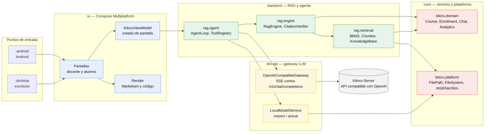
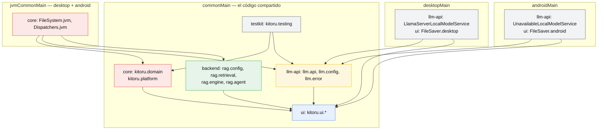
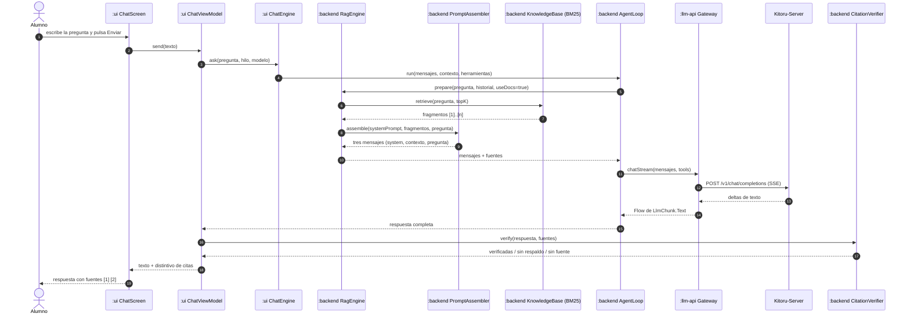
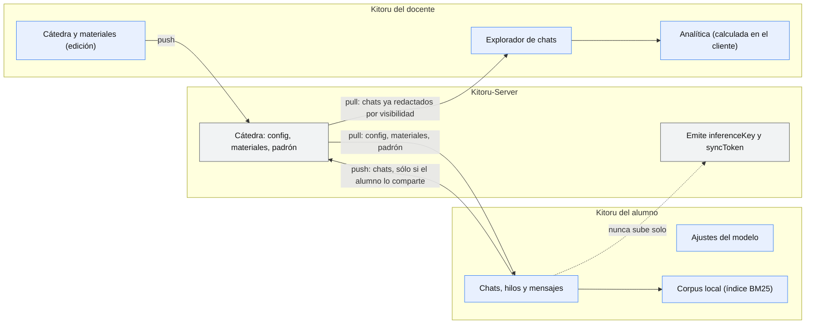

# Arquitectura de Kitoru

> **Audiencia**: desarrollador (y agentes de IA).
>
> **Qué es este documento**: dónde está cada cosa y por qué está así. Responde
> "¿cómo se arma una respuesta?", "¿qué puedo usar en `commonMain`?" y "¿por
> qué el dominio no importa nada de `java.*`?".
>
> **Qué NO es**: no es el manual de uso (van en `docs/MANUAL-DOCENTE.md` y
> `docs/MANUAL-ALUMNO.md`), ni la memoria de diseño (esa está en
> `docs/design/`), ni el mapa de ports desde FunshiEngineAI (ese está en
> [`PORTS.md`](PORTS.md)).

---

## 1. Visión general

Kitoru es una aplicación **de escritorio y Android** (Kotlin Multiplatform +
Compose Multiplatform) con **dos entornos**:

1. **Alumno**. Se inscribe en una cátedra con un código, chatea con un modelo
   de IA y decide **qué ve su docente**. El RAG del chat usa **el material que
   subió la cátedra**, no documentación general.
2. **Docente**. Diseña la cátedra, sube materiales, fija la configuración base
   del modelo y accede a los chats de sus alumnos para analizar **estadísticas,
   comportamiento y calidad de las respuestas**.

Un tercer actor, el **Kitoru-Server** (repo hermano, futuro), es la app de
escritorio que aloja el modelo y emite API keys para la institución. Kitoru
**no lo necesita**: el alumno puede usar un modelo local, y el docente puede
trabajar sin servidor. Cuando el servidor está, es el que aplica la
visibilidad de forma descentralizada.

Las tres reglas que sostienen el diseño:

| Regla | Qué significa en el código |
|---|---|
| **Reutilizar, no reescribir** | Lo que existe en FunshiEngineAI se porta (ver [`PORTS.md`](PORTS.md)). |
| **Portable por defecto** | `commonMain` no importa `java.*`, `javax.*` ni `android.*`. Todo lo específico de plataforma pasa por un seam `expect`/`actual`. |
| **Determinista** | La analítica y la verificación de citas no llaman al modelo ni a la red: son funciones puras. |

---

## 2. Módulos

| Módulo | Paquete raíz | Depende de | Targets | Qué **no** puede contener |
|---|---|---|---|---|
| `:core` | `kitoru.domain`, `kitoru.platform` | — (sólo `kotlinx.coroutines` y `kotlinx.serialization`) | `jvm("desktop")`, `androidTarget` | Nada de `java.*` en el dominio; nada de UI; nada de red. |
| `:llm-api` | `llm.api`, `llm.config`, `llm.error` | `api(project(":core"))` | `jvm("desktop")`, `androidTarget` | Nada de RAG, nada de dominio de cátedra, nada de `HttpClient(CIO)`. |
| `:backend` | `rag.config`, `rag.retrieval`, `rag.engine`, `rag.agent` | `api(project(":core"))`, `api(project(":llm-api"))` | `jvm("desktop")`, `androidTarget` | Nada de UI; nada de persistencia de la app (el dominio la tiene). |
| `:ui` | `kitoru.ui` | `api` de `:core`, `:llm-api`, `:backend` | `jvm("desktop")`, `androidTarget` | Nada de I/O directo: toda la persistencia va por repositorios. |
| `:desktop` | `com.funshiengine.kitoru.desktop` | `implementation(project(":ui"))` | JVM | Nada de lógica: sólo `main`, la carpeta de datos y la ventana. |
| `:android` | `com.funshiengine.kitoru` | `implementation(project(":ui"))` | Android | Ídem: sólo `MainActivity`. |
| `:testkit` | `kitoru.testing` | `api` de `:core`, `:llm-api` | `jvm("desktop")`, `androidTarget` | Nada de producción: sólo dobles y *fixtures* de prueba. |

**Figura 1 — La arquitectura por módulos**



*Pie*: azul `:ui`, verde `:backend`, amarillo `:llm-api`, rojo `:core`, gris lo que
está fuera del proceso (el servidor). Las flechas van **hacia** la dependencia:
`:ui` conoce a `:backend`, `:backend` conoce a `:llm-api` y a `:core`.

---

## 3. Mapa de paquetes

### 3.1 `kitoru.platform` — el seam de portabilidad

| Tipo | Qué es |
|---|---|
| `FilePath` | Ruta **opaca** (`value`, `name`, `extension`, `parent`, `resolve`, `relativeTo`). Envuelve la ruta real para que el dominio no dependa de `java.nio.file`. |
| `FileSystem` | Interfaz mínima de disco: `exists`, `isDirectory`, `sizeBytes`, `readText`, `writeText`, `delete`, `createDirectories`, `listFiles`, `copy`. |
| `systemFileSystem()` | `expect`: la implementación real (`java.io.File`). |
| `stripDiacritics(text)` | `expect`: "Definición" → "Definicion". Base de la tokenización del BM25 y de la comparación de citas. |
| `nowMillis()` | `expect`: el reloj del sistema. |
| `ioDispatcher` | `expect`: el dispatcher de E/S. |
| `KitoruPaths` | `dataDir` (lo fija la app al arrancar), `configDir`, `coursesDir`, `cacheDir`. |
| `kitoru.platform.log` | `Logger`, `LogLevel`, `LogRecord` y `SecretRedactor`: la redacción de secretos se aplica **en el logger**, antes de construir el registro, para que ni el archivo ni el buffer circular filtren una API key. |

### 3.2 `kitoru.domain` — el modelo

| Archivo | Tipos | Qué es |
|---|---|---|
| `Course.kt` | `Course`, `Enrollment`, `MaterialKind`, `Material` | La cátedra, quién está inscribed, y el material que sube el docente. |
| `Roles.kt` | `CourseRole`, `UserProfile`, `ChatVisibility` | Los tres roles (`TITULAR`, `AYUDANTE`, `ALUMNO`) y los tres niveles de visibilidad (`FULL`, `METRICS_ONLY`, `NONE`). |
| `ModelPolicy.kt` | `ModelMode`, `LockedField`, `ModelPolicy` | La configuración base que impone la cátedra, con los campos que el alumno no puede tocar. |
| `Chat.kt` | `ChatThread`, `ChatMessage`, `CitationStats`, `ToolCallStats` | Las conversaciones. `ChatMessage` es a la vez lo que se muestra, lo que se guarda y lo que consume la analítica. |
| `Analytics.kt` | `StudentAnalytics`, `CourseAnalytics`, `DayActivity`, `SourceUsage` | Los agregados que ve el docente. |
| `AnalyticsAnalyzer.kt` | `AnalyticsAnalyzer` | La función pura que calcula la analítica. |
| `Capabilities.kt` | `Capability`, `CapabilityArea`, `Verdict`, `PermissionMatrix`, `PermissionResolver`, `effectiveVisibility(...)` | La matriz rol × capacidad (64 capacidades en 7 áreas) y el resolvedor. |
| `AccessLog.kt` | `AccessLog`, `AccessLogEntry`, `AccessBasis`, `AccessOutcome` | El registro **append-only** de los accesos del docente: quién, qué, cuándo, a quién y con qué resultado. |
| `CoursePrompt.kt` / `PromptModes.kt` | `CoursePromptTemplate`, `PromptModes`, `PromptRenderer`, `PromptVariables` | Los modos de prompt de fábrica (Estricto, Tutor, Corregidor) y su interpolación. |
| `CorpusManifest.kt` | `ChunkingConfig`, `ManifestEntry` | El manifiesto del corpus: qué material hay y con qué troceado se indexó. |
| `Repositories.kt` | `CourseRepository`, `EnrollmentRepository`, `MaterialRepository`, `ThreadRepository`, `MessageRepository`, `ProfileRepository` | Los contratos de persistencia. |
| `FileRepositories.kt` | `File*Repository` | Las implementaciones sobre `JsonListStore`. |
| `JsonStore.kt` | `KitoruJson`, `JsonStore<T>`, `JsonListStore<T>` | El guardado: un JSON por tipo dentro de `config/`, con `Mutex` y escritura serializada. |

### 3.3 `llm.api`, `llm.config`, `llm.error`

| Tipo | Qué es |
|---|---|
| `LlmGateway` | El contrato: `chatStream(messages, tools): Flow<LlmChunk>`, `chatText`, `chat`, `listModels`, `close`. No sabe si detrás hay llama.cpp, Ollama o el Kitoru-Server. |
| `OpenAiCompatibleGateway` | El cliente real: SSE contra `/v1/chat/completions`, acumula los `delta.tool_calls` fragmentados y clasifica los errores HTTP en `LlmException`. |
| `LlmChunk` | `Text(delta)` \| `ToolCall(id, name, argsJson)`. |
| `ToolSpec` | `name`, `description`, `parametersSchema` (el JSON Schema como texto). |
| `LocalModelService` | `expect fun createLocalModelService()`: en escritorio levanta `llama-server`; en Android es un stub que lanza `LlmException`. |
| `ChatMessage` | El mensaje de conversación en formato OpenAI. |
| `GatewayConfig` | El puente entre `kitoru.domain.ModelPolicy` y la capa de red. |
| `LocalModelSettings` | Los parámetros del modelo local (repo de HF, archivo, puerto, contexto, capas en GPU). |
| `LlmErrorCode` / `LlmException` | Los errores tipados: `SIN_CUOTA`, `CLAVE_INVALIDA`, `TIMEOUT`, `NO_CONFIGURADO`, `MODELO_NO_DISPONIBLE`, `CONTEXTO_AGOTADO`, `DESCARGA_FALLIDA`, `SERVIDOR_CAIDO`, `CANCELADO`, `DESCONOCIDO`. |

### 3.4 `rag.*`

| Paquete | Tipos | Qué es |
|---|---|---|
| `rag.config` | `RagConfig` | Los parámetros del RAG **por cátedra**: `chunkSize`, `chunkOverlap`, `topK`, `historyTurns`, `extensions`. |
| `rag.retrieval` | `Doc`, `Chunk`, `Bm25Index`, `Chunker`, `DocumentSource`, `CourseMaterialSource`, `InMemorySource`, `KnowledgeBase` | El corpus: de dónde salen los documentos, cómo se trocean y cómo se recuperan. |
| `rag.engine` | `RagEngine`, `Prepared`, `PromptAssembler`, `CitationVerifier`, `CitationReport`, `CitationCheck`, `KeyTerm` | El armado del prompt y la verificación de las citas. |
| `rag.agent` | `Tool`, `ToolContext`, `ToolResult`, `Artifact`, `ToolCategory`, `ToolOrigin`, `PermissionDecision`, `PermissionRequest`, `ToolRegistry`, `ToolPermissions`, `ToolCallSanitizer`, `AgentLoop`, `AgentEvent`, `AgentAnswer` | El bucle de tool-calling y la puerta de permisos. |
| `rag.agent.tools` | `GetTimeTool`, `CreateFileTool` | Las dos herramientas que hay hoy. |

### 3.5 `kitoru.ui`

| Paquete | Qué es |
|---|---|
| `kitoru.ui` | `KitoruApp` (la raíz que decide qué se ve según el rol) y `KitoruViewModel` (el estado raíz con `mutableStateOf`). |
| `kitoru.ui.course` | Las acciones de cátedra: crear, unirse, invitar (funciones de extensión del ViewModel). |
| `kitoru.ui.chat` | `ChatScreen`, `ChatViewModel`, `ChatEngine`: el chat con streaming, fuentes y distintivo de citas. |
| `kitoru.ui.student` | `StudentHomeScreen`, `StudentModelScreen`, `StudentMaterialsScreen`. |
| `kitoru.ui.teacher` | `TeacherHomeScreen`, `TeacherCourseScreen`, `TeacherMaterialsScreen`, `TeacherAnalyticsScreen`, `TeacherChatsScreen` (que incluye `TeacherStudentsScreen`). |
| `kitoru.ui.components` | `Markdown`, `CodeBlock`, `MathSegment`, `ChatParts`, `MetricCard`: el render propio. |
| `kitoru.ui.platform` | `rememberFileSaver()`: el seam del "guardar como…". |
| `kitoru.ui.theme` | `KitoruAccent` y el tema Material 3. |

---

## 4. Estructura de directorios

```
Kitoru/
├── settings.gradle.kts            # los siete módulos
├── gradle.properties              # kotlin.code.style=official, caché, jerarquía manual
├── gradle/libs.versions.toml      # versiones: Kotlin, Compose, AGP, Ktor, coroutines, JUnit
├── core/
│   ├── build.gradle.kts
│   └── src/
│       ├── commonMain/kotlin/kitoru/domain/      # el modelo
│       ├── commonMain/kotlin/kitoru/platform/    # el seam (+ platform/log)
│       ├── commonTest/kotlin/kitoru/domain/      # tests con kotlin.test
│       └── jvmCommonMain/kotlin/kitoru/platform/ # los actual de desktop y android
├── llm-api/
│   └── src/
│       ├── commonMain/kotlin/llm/{api,config,error}/
│       ├── desktopMain/kotlin/llm/api/          # LocalModelService real
│       └── androidMain/kotlin/llm/api/          # LocalModelService stub
├── backend/
│   └── src/
│       ├── commonMain/kotlin/rag/{config,retrieval,engine,agent}/
│       ├── commonTest/kotlin/                    # tests nuevos (kotlin.test)
│       └── desktopTest/kotlin/rag/               # los tests portados (JUnit 5)
├── ui/
│   └── src/
│       ├── commonMain/kotlin/kitoru/ui/
│       ├── desktopMain/kotlin/kitoru/ui/platform/
│       └── androidMain/kotlin/kitoru/ui/platform/
├── desktop/src/main/kotlin/com/funshiengine/kitoru/desktop/Main.kt
├── android/src/main/kotlin/com/funshiengine/kitoru/MainActivity.kt
├── testkit/src/commonMain/kotlin/kitoru/testing/
└── docs/
    ├── ARCHITECTURE.md           # este documento
    ├── PORTS.md                  # el mapa de ports desde FunshiEngineAI
    ├── design/                   # la memoria de diseño (no es documentación de uso)
    └── img/                      # capturas
```

**Figura 2 — Los source sets y quién depende de quién**



*Pie*: azul `:ui`, verde `:backend`, amarillo `:llm-api`, rojo `:core`, gris los
source sets que no son `commonMain` (los `actual` por platform y `:testkit`).
`commonMain` no puede importar `java.*`. `jvmCommonMain` es el único source set
que comparten los dos platforms JVM. `desktopMain` y `androidMain` **nunca** se
importan entre sí.

---

## 5. Source sets y portabilidad

| Source set | Qué lo usa | Puede usar | **No** puede usar |
|---|---|---|---|
| `commonMain` | todos los módulos | `kotlin.*`, `kotlinx.coroutines.*`, `kotlinx.serialization.*`, `ktor-client-core` | `java.*`, `javax.*`, `android.*`, `java.nio.file`, `java.time`, `java.awt`, `ProcessBuilder`, `System.getenv`, el reloj real |
| `jvmCommonMain` | `:core` (y `:llm-api`, `:backend`, `:ui` cuando haga falta) | lo de `commonMain` + `java.io.*`, `java.util.*`, `javax.crypto` | `java.nio.file` (API 26; `minSdk` es 24), `java.awt`, `javax.swing`, `ProcessBuilder` |
| `desktopMain` | `:llm-api`, `:ui`, `:desktop` | lo de `jvmCommonMain` + `java.awt`, `javax.swing`, `ProcessBuilder`, `skiko` | nada propio de Android |
| `androidMain` | `:llm-api`, `:ui`, `:android` | lo de `jvmCommonMain` + `android.*` | `java.awt`, `javax.swing`, `java.nio.file` |
| `commonTest` | `:core`, `:llm-api`, `:backend`, `:ui` | `kotlin.test`, `kotlinx.coroutines.test` | lo mismo que `commonMain` |
| `desktopTest` | `:backend` | JUnit 5 + `kotlinx.coroutines.test` | — |

### 5.1 La tabla de seams `expect`/`actual`

| `expect` (en `commonMain`) | `actual` en `jvmCommonMain` | `actual` en `desktopMain` | `actual` en `androidMain` | Motivo |
|---|---|---|---|---|
| `kitoru.platform.systemFileSystem(): FileSystem` | `FileSystem.jvm.kt` sobre `java.io.File` | hereda | hereda | `java.io.File` existe desde la API 1: el mismo código sirve para los dos platforms sin *desugaring*. `java.nio.file` sería API 26 y `minSdk` es 24. |
| `kitoru.platform.stripDiacritics(text): String` | `FileSystem.jvm.kt`: `java.text.Normalizer` (NFD) + `Regex("\\p{M}+")` | hereda | hereda | Sin normalizar, "Definición" y "definicion" no se encuentran ni en el índice ni en la verificación de citas. `Normalizer` está disponible en Android. |
| `kitoru.platform.nowMillis(): Long` | `FileSystem.jvm.kt` → `System.currentTimeMillis()` | hereda | hereda | El reloj es inyectable: sin eso los tests no son deterministas. |
| `kitoru.platform.ioDispatcher: CoroutineDispatcher` | `Dispatchers.jvm.kt` → `Dispatchers.IO` | hereda | hereda | El código de red y de disco no debe saber en qué platform corre. |
| `llm.api.createLocalModelService(): LocalModelService` | — | `LlamaServerLocalModelService` (proceso hijo `llama-server`) | `UnavailableLocalModelService` (lanza `LlmException`) | En Android no hay `llama-server`: el stub devuelve un error **explícito** ("El modelo local todavía no está disponible en Android") en vez de fallar de forma confusa. |
| `kitoru.ui.platform.rememberFileSaver()` | — | `FileSaver.desktop.kt` (diálogo de Swing) | `FileSaver.android.kt` (SAF / `CreateDocument`) | "Guardar como…" necesita un selector de archivos nativo, y cada platform lo tiene distinto. |

### 5.2 Las tres reglas

1. **Si necesitás una capacidad de plataforma, va en `kitoru.platform` como `expect`/`actual`, no se usa directo.**
2. **`desktopMain` y `androidMain` nunca se importan entre sí.** Si algo se usa en los dos, va a `jvmCommonMain`.
3. **El dominio (`kitoru.domain`) no importa nada de `java.*`, ni siquiera en `commonMain`.** Si un tipo del dominio necesita una ruta, usa `FilePath`, no `java.io.File`.

### 5.3 Dos trampas que ya están pisadas

| Trampa | Qué pasó | Cómo se evita |
|---|---|---|
| `HttpClient(CIO)` en `commonMain` | El motor CIO no existe en Android. | `HttpClient()` sin argumento: el runtime lo resuelve por el classpath (CIO en escritorio, OkHttp en Android). |
| `Dispatchers.IO` en `commonMain` | No compila en el código común. | `kitoru.platform.ioDispatcher`. |

---

## 6. El dominio

| Tipo | Invariante |
|---|---|
| `Course` | Tiene `joinCode` (con el que el alumno se inscribe), `modelPolicy` (la base que impone), `systemPrompt`, `topK`, `chunkSize`, `analyticsEnabled` y `allowLocalModels`. |
| `Enrollment` | Une una persona con una cátedra y le da un **rol** y una **visibilidad**. El rol no es un flag global: una persona puede ser titular en una cátedra y alumno en otra. |
| `Material` | El texto extraído (`extractedText`) es lo que se indexa; `visible = false` saca el material del índice **y** de la lista del alumno. |
| `ChatThread` | Pertenece a una cátedra (`courseId`) y a un autor (`authorId`). Guarda el modelo que usó (`modelLabel`) y la configuración efectiva. |
| `ChatMessage` | Es `user` o `assistant`. Lleva `sources`, `citation`, `toolCalls`, `latencyMs`, `tokensIn`, `tokensOut`: con eso el docente mide la calidad sin depender del modelo. |
| `ModelPolicy` | `resolveFor(studentChoice)` aplica los bloqueos: si `allowStudentOverride` es `false`, gana la cátedra entera; si no, gana el alumno **salvo** en los campos de `lockedFields`. |
| `ChatVisibility` | `FULL` (texto y métricas), `METRICS_ONLY` (sólo métricas), `NONE` (nada). |
| `LockedField` | Los siete campos bloqueables: `API_KEY`, `BASE_URL`, `MODEL_NAME`, `SYSTEM_PROMPT`, `TEMPERATURE`, `MAX_TOKENS`, `TOP_K`. |

### 6.1 Permisos y visibilidad efectiva

La **visibilidad efectiva** es el **mínimo** de tres ejes:

```
efectiva = min(tope del docente, techo de la inscripción, preferencia del alumno)
```

y es **fail-closed**: sin consentimiento explícito del alumno, la visibilidad
nunca es `FULL` (baja a `METRICS_ONLY`). La función que la calcula es
`effectiveVisibility(...)`, en `kitoru.domain.Capabilities`, y la matriz
rol × capacidad (64 capacidades en 7 áreas) dice qué puede hacer cada rol.

Todo acceso del docente que sea auditable queda anotado en el `AccessLog`
(*append-only*, con tope de entradas y persistido en
`config/access-log.json`), y **el alumno puede leerlo**: el registro guarda no
sólo *qué* pasó, sino **en qué se basó** (`AccessBasis`: el rol y el
consentimiento).

---

## 7. Persistencia

- **Un JSON por tipo**, dentro de `config/`: `courses.json`,
  `enrollments.json`, `materials.json`, `threads.json`, `messages.json`,
  `profiles.json`, `access-log.json`.
- **`JsonStore<T>` / `JsonListStore<T>`** sobre `kitoru.platform.FileSystem`:
  el sistema de archivos es **inyectable**, así que los tests usan
  `kitoru.testing.InMemoryFileSystem` y no tocan el disco.
- **Escrituras serializadas** con un `Mutex` por archivo: dos corrutinas no se
  pisan el mismo JSON.
- **`KitoruJson`** = `Json { prettyPrint = true; ignoreUnknownKeys = true;
  encodeDefaults = true }`. `ignoreUnknownKeys` es lo que permite que un
  cliente viejo no reviente con un archivo nuevo; `encodeDefaults` hace que el
  archivo sea legible a mano.
- **Campos nuevos al final, con valor por defecto**: un JSON viejo siempre se
  puede leer.
- **Si el archivo está roto**, el store devuelve el vacío en vez de voltear la
  app.

**Las carpetas de trabajo** (`KitoruPaths`):

| Carpeta | Qué hay |
|---|---|
| `dataDir` | La raíz. En escritorio, `<user.home>/.kitoru` (o `-Dkitoru.home=…` / `KITORU_HOME`); en Android, `context.filesDir/kitoru`. |
| `configDir` | Los JSON de arriba. |
| `coursesDir` | Los datos por cátedra: materiales, índice, salidas de herramientas. |
| `cacheDir` | Lo que se puede volver a descargar. |

---

## 8. Flujos principales

### 8.1 Una pregunta con RAG

**Figura 3 — El flujo de una pregunta**



*Nota al pie*: el paso de verificación es **determinista**: no llama al modelo
ni a la red, por eso la calidad de las citas se puede medir al 100 %.

El prompt que ve el modelo tiene **tres** mensajes: el `system` (el kernel de la
app + el prompt del docente, interpolado), el material entre `<<<CONTEXTO>>>` y
`<<<FIN CONTEXTO>>>`, y la pregunta entre `<<<PREGUNTA>>>` y
`<<<FIN PREGUNTA>>>`. **Aislar la pregunta en su propio mensaje** es la primera
defensa contra la inyección de prompt.

### 8.2 Indexar desde cero

El `KnowledgeBase.sync(onStatus)` carga las fuentes (`DocumentSource.load()`),
trocea con `Chunker.split(doc, chunkSize, chunkOverlap)` y construye el
`Bm25Index`. Corre en `ioDispatcher` y reporta el progreso por `onStatus`.
El `sources` es mutable: cuando el docente sube material, se reindexa en
caliente, sin reiniciar la app.

El corpus es **la cátedra**: `CourseMaterialSource` toma los materiales
visibles con texto extraído y los convierte en `Doc`. `DocumentSource` es una
interfaz, así que una fuente nueva (un servidor remoto, un libro) entra sin
tocar el motor de recuperación.

### 8.3 La sincronización con el servidor

**Figura 4 — Quién es la fuente de verdad de qué**



*Pie*: el **servidor es la fuente de verdad de la cátedra**; el **alumno es la
fuente de verdad de sus conversaciones**. La analítica **no la calcula el
servidor**: la calcula el cliente del docente con `AnalyticsAnalyzer.analyze`.
Los chats con IA local **nunca se suben solos**: subirlos es un acto
explícito del alumno. (El contrato completo está en
[`docs/design/sync/01-contrato.md`](design/sync/01-contrato.md); la fase de
sincronización todavía no está implementada.)

### 8.4 El cambio de visibilidad

La visibilidad no es un valor que la UI pueda cambiar por su cuenta: es el
resultado de `effectiveVisibility(...)`, y los tres ejes se combinan con el
mínimo. Cuando el alumno baja su nivel, el efecto se nota en dos lugares a la
vez: el explorador de chats del docente deja de mostrar el texto **y** el
repositorio de mensajes **no se invoca** (el filtro está en la frontera, no en
la pantalla).

---

## 9. Concurrencia

- **`ioDispatcher`** para el I/O (indexación, lectura y escritura de JSON,
  red). **`Dispatchers.Main`** para la UI. El dispatcher se pide **siempre**
  explícito: no hay `Dispatchers.IO` en `commonMain`.
- **La UI no hace I/O**: `KitoruViewModel` lanza en su propio
  `CoroutineScope(SupervisorJob() + Dispatchers.Main)` y delega en los
  repositorios (que son `suspend`).
- **La cancelación se propaga**: `CancellationException` se re-lanza tal cual;
  `LlmException.wrap` la traduce a `LlmErrorCode.CANCELADO` sólo en la frontera
  de la UI, nunca al revés.
- **El streaming** se consume con `Flow` + `flowOn(ioDispatcher)`: el
  `AgentLoop` emite `AgentEvent.Text` a medida que llegan los deltas.
- **Los timeouts son parámetros inyectados** (`chatTimeoutMs`, `toolTimeoutMs`),
  nunca `Thread.sleep`.
- **`Mutex` por archivo** en `JsonStore`: las escrituras no se pisan.

---

## 10. Manejo de errores

- **`LlmException` + `LlmErrorCode`**: cada error sabe si es reintentable
  (`retryable`) o terminal, para que quien llama decida sin parsear mensajes.
- **`fromHttp(status, body, local)`** clasifica la respuesta HTTP:
  `401/403` → `CLAVE_INVALIDA`, `429` → `SIN_CUOTA`, `408` → `TIMEOUT`,
  `400` con indicios de tokens → `CONTEXTO_AGOTADO`, `404` →
  `MODELO_NO_DISPONIBLE`, `5xx` → `MODELO_NO_DISPONIBLE`.
- **`wrap(t)`** normaliza cualquier `Throwable`. Es portable: **no** mira tipos
  de `java.io` (no existen en el código común de Android), sino el mensaje.
- **`validate()`** devuelve **todos** los problemas, no el primero:
  `"La temperatura debe estar entre 0 y 2 (actual: $temperature)."`
- **Los mensajes de error son contrato con el usuario**: van en español,
  terminan en punto, e incluyen el valor actual entre paréntesis cuando eso
  ayuda a arreglarlo. Si un texto de error aparece en la UI, aparece literal
  en el manual del docente.
- **El `logger` redacta secretos antes de construir el registro**: una API key
  no llega ni al archivo, ni al buffer circular, ni al portapapeles del
  diagnóstico.

---

## 11. La analítica

`AnalyticsAnalyzer.analyze(course, enrollments, threads, messages)` es una
**función pura**: no toca disco ni red. Por eso se puede testear al 100 % y
auditar.

| Agregado | Qué trae |
|---|---|
| `StudentAnalytics` | Mensajes, respuestas, hilos, días activos, latencia media, tokens, citas (verificadas / sin respaldo / inexistentes), herramientas invocadas y falladas, `citationSupportRate`, `ungroundedAnswerRate`. |
| `CourseAnalytics` | Alumnos, alumnos activos, docentes, totales, `avgMessagesPerStudent`, `citationSupportRate`, el desglose de citas y el uso por fuente. |
| `DayActivity` | Actividad por día (para el gráfico de comportamiento). |
| `SourceUsage` | Cuántas veces se consultó cada fuente del corpus. |

**Lo que la analítica excluye**: los alumnos con visibilidad `NONE` no aparecen
en ningún agregado (no cuentan como cero: no aparecen). Y el texto de las
conversaciones no se usa para comparar alumnos entre sí: no hay rankings ni
scores.

---

## 12. Configuración

La configuración del modelo es **de la cátedra**, con libertad para el alumno:

```
Course.modelPolicy  ──►  ModelPolicy.resolveFor(ajuste del alumno)  ──►  GatewayConfig  ──►  OpenAiCompatibleGateway
```

- `ModelPolicy.mode` es `REMOTE` (el servidor de la cátedra, con API key) o
  `LOCAL` (el modelo del alumno).
- `lockedFields` marca los campos que el alumno **no** puede cambiar.
- `resolveFor` es **la única** vía por la que se arma la configuración
  efectiva: la UI nunca manda su propia configuración al gateway, manda el
  resultado de `resolveFor` y el dominio decide.
- `Course.topK`, `Course.chunkSize` y `Course.systemPrompt` son los
  parámetros del RAG de esa cátedra.

---

## 13. Extensibilidad

| Qué se agrega | Dónde |
|---|---|
| **Una herramienta** | Una clase que implementa `rag.agent.Tool` (`spec`, `category`, `execute`) + registrarla en el `ToolRegistry`. Si necesita tocar disco, recibe un `kitoru.platform.FileSystem` inyectado. |
| **Una fuente de documentos** | Una clase que implementa `rag.retrieval.DocumentSource` (`label`, `load()`), y se agrega a `KnowledgeBase.sources`. |
| **Un source set nuevo** | Un `expect` en `commonMain` y su `actual` por platform; se actualiza la tabla de seams (§5.1) y la de portabilidad del [`AGENTS.md`](../AGENTS.md). |
| **Una capacidad o un rol** | La matriz de `kitoru.domain.Capabilities` (`PermissionMatrix.ROWS`), con su condición y su test. |
| **Un tipo de material** | Un valor de `MaterialKind` con su `label` y su extractor en la fase de materiales. |

---

## 14. Requisitos de ejecución

| Requisito | Para qué |
|---|---|
| **JDK 21** | Para correr Gradle (los módulos compilan a bytecode JVM 11). |
| **Android SDK 35** | Sólo para `:android`. Va en `local.properties` (`sdk.dir=…`). |
| **Gradle 8.11.1** | Va por el wrapper. |
| `llama-server` (llama.cpp) y el `.gguf` | **Opcional**: sólo para el modelo local en el escritorio. |

---

## 15. Referencias

| Documento | Para qué |
|---|---|
| [`../README.md`](../README.md) | Qué es Kitoru, cómo compilar, cómo testear y el estado del proyecto. |
| [`PORTS.md`](PORTS.md) | Qué se portó de FunshiEngineAI, qué cambió y por qué. |
| [`../AGENTS.md`](../AGENTS.md) | Las reglas de trabajo: comandos, portabilidad, estilo y qué no tocar. |
| [`design/CONTEXTO.md`](design/CONTEXTO.md) | El contexto compartido del proyecto. |
| [`design/sync/01-contrato.md`](design/sync/01-contrato.md) | El contrato de sincronización con el Kitoru-Server. |
| [`design/process/02-roadmap.md`](design/process/02-roadmap.md) | La hoja de ruta por fases. |
| [`design/process/03-documentacion.md`](design/process/03-documentacion.md) | El plan de documentación: las cuatro audiencias y la estructura de `docs/`. |
