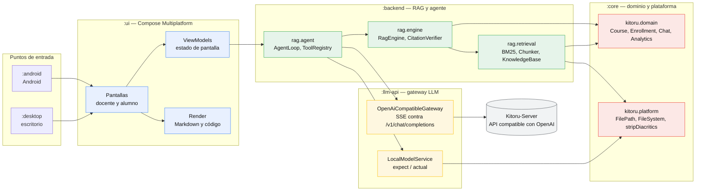
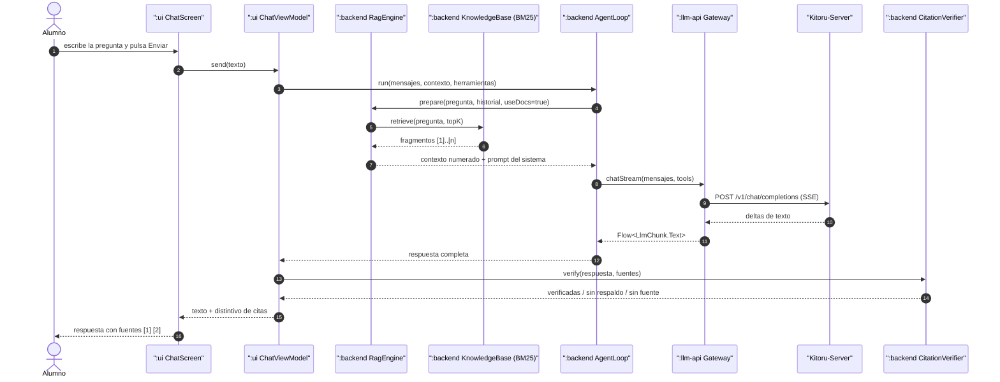
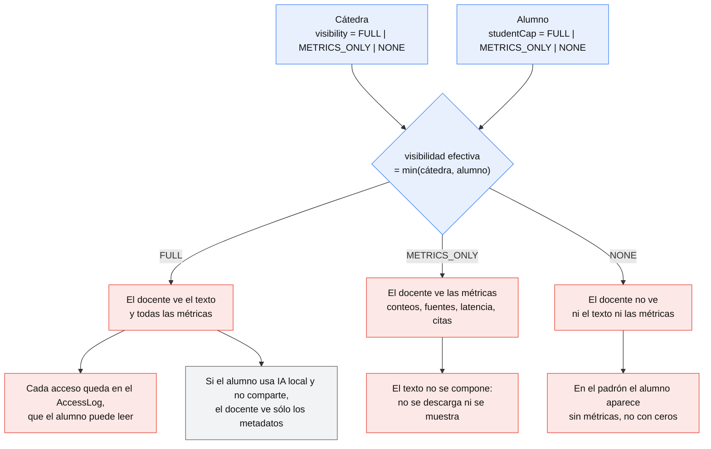

# 03 · Estrategia de documentación de Kitoru

> Documento de diseño. Subtarea: **diseño de la documentación de Kitoru** para sus
> cuatro audiencias (docente, alumno, desarrollador, institución).
>
> Depende de: `docs/design/CONTEXTO.md`, `docs/design/process/02-roadmap.md`,
> `docs/design/domain/*.md`, `docs/design/teacher/*.md`, `docs/design/student/*.md`,
> `docs/design/security/02-privacidad.md`, `docs/design/platform/03-kitoru-server-api.md`,
> `docs/design/sync/01-contrato.md`.
>
> Modelos a seguir: la documentación de **FunshiEngineAI** (`README.md`,
> `docs/MANUAL-RAG.md`, `docs/TESTING.md`, `docs/CHANGES.md`, `docs/ARCHITECTURE.md`,
> `docs/PLAN-INTEGRACION.md`) y los repos hermanos (`Silvy/AGENTS.md`,
> `FunshiEngineCLI/AGENTS.md`, `FunshiEngineCLI/MANUAL_DE_USO.md`,
> `FunshiEngineCLI/PROJECT_STRUCTURE.md`).

---

## 0. Resumen en una línea

La documentación de Kitoru son **cuatro manuales distintos con cuatro autores
distintos**: el del docente (qué diseño y qué veo de mis alumnos), el del alumno
(me uno, chateo, qué veo de mi docente), el del desarrollador (compile, porte, dónde
está cada cosa) y el de la institución (el contrato del Kitoru-Server); todos
viven en `docs/`, todos se escriben en español, y el que más se actualiza
(`CHANGES.md`) se actualiza en el mismo commit del cambio que lo motiva.

---

## 1. Las cuatro audiencias y qué necesitan

### 1.1 Tabla maestra

| Audiencia | Pregunta que se hace | Documento principal | Complementos | Canal | Tono |
|---|---|---|---|---|---|
| **Docente** (usuario final) | «¿cómo armo mi cátedra? ¿qué veo de mis alumnos? ¿qué significa este 82 %?» | `docs/MANUAL-DOCENTE.md` | `docs/MANUAL-RAG.md`, `docs/PRIVACIDAD.md` | repo + PDF + ayuda integrada en la app | imperativo, paso a paso, con capturas |
| **Alumno** (usuario final) | «¿cómo me uno? ¿cómo chateo? ¿qué puedo cambiar? ¿qué ve mi docente?» | `docs/MANUAL-ALUMNO.md` | `docs/PRIVACIDAD.md` (sección del alumno), ayuda **integrada en la app** | app (Ayuda) + repo | breve, directo, con capturas |
| **Desarrollador** (interno) | «¿cómo compilo? ¿dónde está cada cosa? ¿cómo porto una función de FunshiEngineAI?» | `README.md` + `docs/ARCHITECTURE.md` | `AGENTS.md`, `docs/PORTS.md`, `docs/TESTING.md` | repo | técnico, diagramas, tablas de rutas |
| **Institución** (equipo de Kitoru-Server) | «¿cuál es el contrato? ¿cómo emito keys? ¿qué datos ve el servidor?» | `docs/API-KITORU-SERVER.md` | `docs/PRIVACIDAD.md`, `docs/openapi/kitoru-server-v1.yaml` | repo (contrato) + tablero del server | normativas, con esquemas y tabla de errores |

### 1.2 El docente (usuario final)

**Perfil**: profesor titular o ayudante de una carrera. Usa la app 2 veces por
semana. No sabe qué es un `topK` ni le importa. Quiere saber: si la cátedra está
funcionando, quién participa y si las respuestas del modelo están respaldadas.

**Lo que necesita, en orden de urgencia**:

1. **Un camino de 5 minutos**: crear la cátedra → subir un material → copiar el
   código de inscripción → ver a un alumno chateando.
2. **Saber qué significa cada número**. El `82 %` de "citas verificadas" o el
   "7 de 34 activos" no son auto-explicativos. Cada métrica de la app tiene que
   tener una entrada en el manual con: **nombre exacto en la pantalla**, **qué
   mide**, **fórmula exacta** (campo del dominio del que sale), **cómo
   interpretarlo** y **qué NO mide**.
3. **Saber qué ve de sus alumnos** y **por qué un alumno no aparece con datos**.
   Es la pregunta que mássupport tickets va a generar: la visibilidad es
   asimétrica y hay que explicarla sin juridiquês.
4. **Poder ajustar el modelo** sin romper nada: qué puede bloquear, qué efecto
   tiene bloquear un campo, qué ve el alumno cuando el campo está bloqueado.
5. **Un índice de problemas frecuentes** con los mensajes de error literales de
   la app (los mensajes están en español y son el contrato con el usuario: si el
   manual no los reproduce literal, el docente no lo encuentra).

**Formato**: un manual largo (objetivo: 25–40 páginas), en español rioplatense
neutro, con **capturas reales** de la app en cada pantalla y tablas. Un índice
clickeable arriba. Cada capítulo arranca con "Qué vas a poder hacer al terminar".

**Lo que NO necesita**: el diagrama de módulos, el código, los nombres de las
clases, ni por qué se eligió BM25. Eso va en `docs/ARCHITECTURE.md`.

### 1.3 El alumno (usuario final)

**Perfil**: estudiante de 20 años, la app abierta en el teléfono entre clase y
clase. Pregunta dudas de la materia. Es la audiencia más numerosa y la que menos
tiempo tiene.

**Lo que necesita**:

1. **Unirse**: qué es el código de inscripción, dónde lo pone, qué pasa si está
   mal, qué pasa si la inscripción está cerrada.
2. **Chatear**: cómo se escribe, qué significan las citas `[1]`, `[2]` y el
   distintivo de "citas verificadas", por qué a veces el modelo responde "no
   encuentro eso en el material".
3. **Qué puede cambiar del modelo**: la tabla literal de los 7 `LockedField` con
   el efecto de cada bloqueo, y la aclaración de que el RAG **siempre** usa el
   material de la cátedra (aunque cambie el modelo).
4. **Transparencia (lo más importante para esta audiencia)**: una sección
   dedicada y **no escondida** que diga, con las mismas palabras que usa la
   pantalla "Qué ve tu docente": qué ve, qué no ve, cómo bajarlo, cómo pedir
   que lo suban, y que existe un **registro de accesos** que el alumno puede
   leer.
5. **Modo local**: qué cambia cuando el alumno usa su propia IA (nada sale de su
   máquina, el docente ve sólo los metadatos que el alumno comparta).

**Formato**: **corto** (objetivo: 6–10 páginas), en la app (pantalla "Ayuda" con
índice y anclas) **y** en el repo. Mismo texto, dos destinos: el markdown del
repo es la fuente de verdad y la app lo embebe.

**Regla de oro de esta audiencia**: si el alumno tiene que instalar, leer o
configurar algo para leer un capítulo del manual, ese capítulo está mal escrito.

### 1.4 El desarrollador (interno)

**Perfil**: el equipo (o un agente de IA) que mantiene el repo. Ya conoce Kotlin.
Necesita no re-inventar lo que ya está hecho y no romper la portabilidad.

**Lo que necesita**:

1. **Compilar y testear en 30 segundos**: los comandos exactos, qué tarea de Gradle
   genera cada target (`jvm("desktop")` → `desktopTest`), qué falla si falta el SDK
   de Android.
2. **Dónde está cada cosa**: el mapa de módulos, de paquetes y de archivos.
3. **Qué se puede tocar y qué no**: la frontera de portabilidad
   (`commonMain` / `jvmCommonMain` / `desktopMain` / `androidMain`), el seam de
   `kitoru.platform`, y qué archivos son *contrato* (`:core`/`:llm-api`).
4. **Cómo portar una función de FunshiEngineAI**: el método (no reescribir) y el
   mapa de lo ya portado (`docs/PORTS.md`) para no duplicar trabajo.
5. **Las reglas**: idioma, estilo, cómo se testea, qué no se toca, la convención
   de mensajes de error en español.

**Formato**: documentos técnicos densos, con diagramas Mermaid, tablas de rutas
de archivo y enlaces a los símbolos exactos (`kitoru.domain.ModelPolicy`).

### 1.5 El equipo de la institución (Kitoru-Server)

**Perfil**: equipo de sistemas de la universidad. No lee Kotlin; lee JSON y
OpenAPI. Necesita saber exactamente qué tiene que implementar y qué puede ver
de los alumnos.

**Lo que necesita**:

1. **El contrato**: endpoints, esquemas, headers, códigos de error, versión.
2. **Cómo emitir keys**: qué pedir, qué devuelve, cuándo vence, cómo se rota,
   cómo se revoca.
3. **Qué datos ve el servidor**: la lista literal (prompt del sistema + contexto
   RAG + pregunta + respuesta + `X-Kitoru-Student` + IP), qué **no** ve, y qué
   loguea.
4. **Qué responsabilidad tiene** y cuál no (el verificador de citas corre en el
   cliente; la analítica también).

**Formato**: un documento normativo + un **OpenAPI 3.1** que se pueda importar en
Postman/Insomnia. Los mensajes de error del servidor, en español, porque los
muestra la app sin traducir.

### 1.6 Regla de oro: una pregunta → un documento

| Si la pregunta es… | Va a… |
|---|---|
| «¿cómo creo la cátedra?» | `docs/MANUAL-DOCENTE.md` |
| «¿qué significa "citas sin respaldo"?» | `docs/MANUAL-DOCENTE.md` §Analítica |
| «¿me puedo cambiar la temperatura?» | `docs/MANUAL-ALUMNO.md` §Tu modelo |
| «¿qué ve mi docente de mí?» | `docs/MANUAL-ALUMNO.md` §Privacidad |
| «¿cómo compilo y corro los tests?» | `README.md` + `docs/TESTING.md` |
| «¿dónde vive `Course`?» | `docs/ARCHITECTURE.md` |
| «¿esto ya estaba portado?» | `docs/PORTS.md` |
| «¿qué tiene que implementar el server?» | `docs/API-KITORU-SERVER.md` |
| «¿qué pasa con los chats si uso IA local?» | `docs/PRIVACIDAD.md` |
| «¿qué cambió en la v0.3?» | `docs/CHANGES.md` |

Si una pregunta no tiene destino, es que falta un documento o falta una
sección: se agrega, no se improvisa en el chat de soporte.

### 1.7 La documentación dentro de la app (ayuda integrada)

La ayuda del alumno **no** es un PDF: es una pantalla de la app que renderiza el
mismo markdown del repo.

- **Fuente de verdad**: `docs/MANUAL-ALUMNO.md` y `docs/MANUAL-DOCENTE.md`.
- **Copia a la app**: tarea de Gradle `:ui:syncManual` que copia
  `docs/MANUAL-*.md` y `docs/img/**` a `ui/src/commonMain/resources/ayuda/`.
- **Anti-drift**: test `ui/src/desktopTest/kotlin/kitoru/ui/AyudaSincronizadaTest`
  que compara el hash del markdown en el repo con el del recurso empaquetado y
  **falla** si difieren (mensaje: "El manual embebido está desactualizado: corré
  `./gradlew :ui:syncManual`").
- **Render**: el mismo `Markdown` que usa el chat (`ui/.../components/Markdown.kt`),
  con navegación por anclas (`manual-alumno.md#privacidad`).
- **Ayuda contextual**: cada pantalla tiene un `?` que abre el capítulo
  correspondiente.
- **Sin datos personales**: la ayuda embebida no trae ni el nombre de la
  cátedra ni el del alumno; todo es genérico.

---

## 2. La estructura de `docs/`

### 2.1 Árbol de archivos (nombres exactos)

```
Kitoru/
├── README.md                      # qué es, cómo se compila, estado/roadmap
├── AGENTS.md                      # cómo trabaja un agente de IA (y un humano) en el repo
├── LICENSE                        # pendiente de definir
├── docs/
│   ├── ARCHITECTURE.md            # los paquetes, los flujos, los diagramas
│   ├── MANUAL-DOCENTE.md          # manual del docente (usuario final)
│   ├── MANUAL-ALUMNO.md           # manual del alumno (usuario final)
│   ├── MANUAL-RAG.md              # cómo funciona el RAG de la cátedra
│   ├── PLAN-INTEGRACION.md        # fases, criterios de aceptación, riesgos
│   ├── TESTING.md                 # reglas de testing
│   ├── CHANGES.md                 # historial por versión
│   ├── API-KITORU-SERVER.md       # el contrato con la institución
│   ├── PRIVACIDAD.md              # qué se ve, quién lo ve, cómo se borra
│   ├── PORTS.md                   # mapa de ports desde FunshiEngineAI
│   ├── openapi/
│   │   └── kitoru-server-v1.yaml  # contrato legible por máquina
│   ├── img/                       # capturas (docente/, alumno/)
│   │   ├── docente/
│   │   └── alumno/
│   └── design/                    # memoria de diseño (NO es documentación de uso)
│       ├── CONTEXTO.md
│       ├── domain/  teacher/  student/  analytics/  rag/  platform/
│       ├── security/  sync/
│       └── process/               # este documento y los hermanos
└── ui/src/commonMain/resources/ayuda/   # copia embebida de los manuales (generada)
```

**Regla de la frontera** (importante, porque `docs/design/` es enorme):

| Carpeta | Qué es | Quién la lee | ¿Se actualiza con cada cambio? |
|---|---|---|---|
| `docs/*.md` (raíz) | **documentación viva**: cómo está hecho y cómo se usa | las 4 audiencias | sí, cuando el cambio la motiva |
| `docs/design/**` | **memoria de diseño**: por qué se decidió así | el equipo y los agentes | no: es un archivo histórico |
| `docs/img/**` | capturas | todas las audiencias | sí, cuando cambia la pantalla |

`docs/design/` nunca se enlaza desde los manuales: es el cuaderno de trabajo, no
el manual. Y cada documento de `docs/design/` que se completa se marca
`Estado: propuesta cerrada` o `Estado: vigente` en su encabezado (el patrón ya usado
por `docs/design/platform/03-kitoru-server-api.md`).

### 2.2 Índice de cada documento

#### `README.md` (raíz del repo)

Audiencia: las cuatro. Es la puerta de entrada y se lee en 60 segundos.

| # | Sección | Contenido |
|---|---|---|
| 0 | **Qué es Kitoru** | Una línea: «aplicación de escritorio y Android para que una cátedra use una IA con su propio material y vea cómo se usa». Un párrafo de contexto. |
| 1 | **Para quién** | Tabla con los cuatro roles y el enlace a su documento. |
| 2 | **Módulos** | Tabla `:core`, `:llm-api`, `:backend`, `:ui`, `:desktop`, `:android` con una línea de responsabilidad cada uno. |
| 3 | **Requisitos** | JDK 21, Gradle 8.11.1 (wrapper), Android SDK 35 para `:android`, `llama-server` (llama.cpp) sólo para el modelo local. |
| 4 | **Compilar y ejecutar** | `./gradlew :desktop:run`, `./gradlew :android:assembleDebug`, `./gradlew build`. |
| 5 | **Tests** | `./gradlew :backend:desktopTest` y el resto. Enlace a `docs/TESTING.md`. |
| 6 | **Estado / roadmap** | Checklist con checkboxes `[x]`/`[ ]`, una línea por fase, mapeado a `docs/design/process/02-roadmap.md`. Es el formato de FunshiEngineAI. |
| 7 | **Documentación** | La tabla de documentos (como la de FunshiEngineAI): documento → para qué. |
| 8 | **Datos y privacidad** | Dos líneas + enlace a `docs/PRIVACIDAD.md`. |
| 9 | **Licencia** | Enlace. |

Regla: el README **no** duplica contenido: enlaza. Y su sección 6 es la única
fuente de "¿qué falta?" para el usuario.

#### `docs/ARCHITECTURE.md`

Audiencia: desarrollador. Es el documento que responde "¿dónde está cada cosa?".

| # | Sección | Contenido |
|---|---|---|
| 1 | **Visión general** | Qué es Kitoru, los dos entornos (alumno/docente), la relación con Kitoru-Server. |
| 2 | **Módulos** | Tabla con módulo, paquete raíz, dependencias (`api`/`implementation`), targets y qué NO puede contener. |
| 3 | **Mapa de paquetes** | `kitoru.platform`, `kitoru.domain`, `llm.api`, `llm.config`, `llm.error`, `rag.config`, `rag.retrieval`, `rag.engine`, `rag.agent`, `rag.agent.tools`, `kitoru.ui.*` — cada uno con su responsabilidad y sus tipos públicos. |
| 4 | **Estructura de directorios** | Árbol real del repo (los 6 módulos × los 4 source sets). |
| 5 | **Source sets y portabilidad** | `commonMain` / `jvmCommonMain` / `desktopMain` / `androidMain` / `desktopTest`, y la tabla de qué API se puede usar en cada uno. |
| 6 | **El dominio** | `Course`, `Enrollment`, `Material`, `ChatThread`, `ChatMessage`, `ModelPolicy`, `ChatVisibility` — con sus invariantes. |
| 7 | **Persistencia** | `JsonListStore`, un JSON por tipo en `config/`, `KitoruPaths`, y qué pasa cuando cambia un esquema. |
| 8 | **Flujos principales** | (a) una pregunta con RAG; (b) una indexed desde cero; (c) la sincronización con el servidor; (d) el cambio de visibilidad. Con diagramas Mermaid. |
| 9 | **Concurrencia** | `ioDispatcher`, `Dispatchers.Main`, dónde se corta la cancelación, cómo se propaga. |
| 10 | **Manejo de errores** | `LlmException` + `LlmErrorCode`, `validate()` fail-fast, dónde se traduce a texto de UI. |
| 11 | **La analítica** | `AnalyticsAnalyzer` como función pura, qué incluye y qué excluye. |
| 12 | **Configuración** | El `ModelPolicy` de la cátedra, los `LockedField`, `resolveFor(studentChoice)`. |
| 13 | **Direcciones de trabajo** | `KitoruPaths.dataDir/configDir/coursesDir/cacheDir`, qué hay en cada una. |
| 14 | **Extensibilidad** | Cómo se agrega una herramienta, una fuente de documentos, un source set nuevo. |
| 15 | **Requisitos de ejecución** | Los mismos del README, más los opcionales. |
| 16 | **Referencias** | Enlaces a los demás documentos de `docs/`. |

#### `docs/MANUAL-DOCENTE.md`

Audiencia: docente. Objetivo: 25–40 páginas, con capturas.

| # | Capítulo | Contenido |
|---|---|---|
| 1 | **Qué es Kitoru** | Para qué sirve, en una pantalla, sin jerga. Qué es "material", qué es "RAG" (en una frase), qué es "cita verificada". |
| 2 | **Primer arranque (5 minutos)** | Crear la cátedra → subir un material → copiar el código → ver chatear a un alumno. Con capturas de cada paso. |
| 3 | **La cátedra** | Nombre, código, cursada, descripción, qué se puede cambiar después. |
| 4 | **El padrón de alumnos** | Inscripción por código / alta manual / importación CSV. Roles (titular, ayudante, alumno). El código de inscripción y el de ayudantes. |
| 5 | **Los materiales** | Qué formatos se indexan, qué NO (PDF sin extracción), cómo se extrae el texto, las etiquetas, visibilidad por material, reindexado, qué hacer cuando el modelo "no encuentra" algo. |
| 6 | **El prompt de la cátedra** | Qué controla, cómo escribirlo, ejemplos buenos y malos, el efecto sobre las citas. |
| 7 | **La configuración del modelo** | Las 5 secciones de la pantalla: servidor, modelo, generación, RAG, herramientas. Qué es bloqueable y qué pasa cuando algo está bloqueado. |
| 8 | **La analítica de la cátedra** | **El capítulo central.** Cada tarjeta, cada columna y cada número: nombre en pantalla, fórmula exacta, interpretación y qué no mide. Ver la tabla de métricas en §2.3. |
| 9 | **La calidad de las respuestas** | El verificador determinista, los 4 motivos de fallo (`no_apoya`, `detalle_inventado`, `fuente_inexistente`, `fuente_vacia`), el panel de respuestas problemáticas, el cruce por material y las acciones correctivas. |
| 10 | **Los chats de los alumnos** | El explorador de chats, qué se ve según la visibilidad, el registro de accesos. |
| 11 | **Privacidad y datos** | Visibilidad, el `min(lo que pide la cátedra, lo que acepta el alumno)`, solicitudes, auditoría, exportación, baja y supresión. |
| 12 | **El Kitoru-Server** | Cómo pegar la URL y la key, cómo pedir una key al servidor, "Probar conexión", qué hacer si el modelo no responde. |
| 13 | **Problemas frecuentes** | Tabla: síntoma → causa → qué hacer. Con los mensajes de error literales. |
| 14 | **Glosario** | `chunk`, `topK`, `cita verificada`, `tasa de citas`, `IA alojada`, `IA local`, `visibilidad`, `token`. |

#### `docs/MANUAL-ALUMNO.md`

Audiencia: alumno. Objetivo: 6–10 páginas. Es el mismo texto que embebe la app.

| # | Capítulo | Contenido |
|---|---|---|
| 1 | **Qué es esta app** | Un párrafo. Un chat con una IA que responde **con el material de tu cátedra**. |
| 2 | **Unirte a la cátedra** | El código, dónde escribirlo, qué pasa si está mal, qué pasa si la cátedra está cerrada. |
| 3 | **El chat** | Escribir y enviar, el streaming, las citas `[1] [2]`, "copiar", "empezar de nuevo", los adjuntos. |
| 4 | **El distintivo de citas** | "Citas verificadas (3)", "2 citas sin respaldo", "1 sin fuente": qué significan y qué tenés que hacer. |
| 5 | **Tu modelo** | La tabla de los 7 campos bloqueables: qué podés cambiar siempre, qué cambia cuando la cátedra bloquea, qué pasa con la temperatura. El aviso de que **el RAG siempre usa el material de la cátedra**. |
| 6 | **Herramientas y permisos** | Qué herramientas existen, que piden permiso, que el permiso es por chat. |
| 7 | **Privacidad: qué ve tu docente** | **Sección de primera clase.** La misma tabla literal de la pantalla. Cómo bajar la visibilidad. Cómo pedir que la suban. El registro de accesos. Cómo borrar tus datos. |
| 8 | **Usar tu propia IA (modo local)** | Qué cambia: nada sale de tu máquina, el docente no ve el texto, sólo los metadatos que compartas. Cómo se instala `llama-server`. |
| 9 | **Problemas frecuentes** | "No encuentro eso en el material", "la app no abre", "el modelo no responde", "cambié la clave y dejó de funcionar". |
| 10 | **Ayuda dentro de la app** | Dónde está el botón `?`, cómo volver al índice. |

#### `docs/MANUAL-RAG.md`

Audiencia: docente (técnico-curioso) + desarrollador. Es el heredero directo de
`FunshiEngineAI/docs/MANUAL-RAG.md`, **adaptado al corpus de la cátedra**.

| # | Sección | Contenido |
|---|---|---|
| 1 | **Qué es "usar el material de la cátedra como fuente"** | El flujo: material → índice → contexto `[1] [2]` → respuesta → verificación. |
| 2 | **De dónde sale el conocimiento** | Una sola fuente: los materiales de la cátedra. Etiqueta de la cita (`cátedra: Título del material`). Qué materiales no se indexan. |
| 3 | **Cómo se indexa** | Troceado por encabezados y por tamaño (`chunkSize`, `chunkOverlap`), BM25, normalización sin acentos, `topK`. |
| 4 | **Cómo escribir el material para que se encuentre** | Los consejos de FunshiEngineAI adaptados: usá los términos que van a aparecer en la pregunta, una sección por concepto, 800–1500 caracteres por sección, repetí el término clave en el título. |
| 5 | **Cómo se responde y cómo se citan las fuentes** | El formato del `CONTEXTO`, el formato de `Fuentes:` al pie, qué pasa si el modelo no cita. |
| 6 | **La verificación de citas** | Las 3 reglas (literal / sin detalles inventados / paráfrasis), la tabla de distintivos, qué hacer cuando una cita sale sin respaldo. |
| 7 | **Herramientas en el chat de la cátedra** | Las que hay, sus categorías, los permisos por chat. |
| 8 | **Configuración que afecta al RAG** | `chunkSize`, `chunkOverlap`, `topK`, `historyTurns`, `extensions` — qué hace cada una al cambiarla. |
| 9 | **Recetas** | «Quiero que el modelo use mi material», «el modelo no encuentra lo que le pregunto», «quiero que la respuesta cite siempre», «cambié un material y no se actualiza». |
| 10 | **Problemas frecuentes** | Tabla. |
| 11 | **Límites conocidos** | Sin embeddings (BM25 no entiende sinónimos), sin OCR, la verificación no corrige, la citación no es multi-idioma. |
| 12 | **Referencias** | `ARCHITECTURE.md`, `PLAN-INTEGRACION.md`, `TESTING.md`. |

#### `docs/PLAN-INTEGRACION.md`

Audiencia: desarrollador + institución. Es el **plan vivo** (a diferencia de
`docs/design/process/02-roadmap.md`, que es el plan de diseño).

| # | Sección | Contenido |
|---|---|---|
| 1 | **Contexto y objetivo** | Qué se está construyendo y por qué. |
| 2 | **Decisiones cerradas** | Tabla: decisión → motivo → documento que la originated. |
| 3 | **Fases** | Tabla maestra: Fase | Alcance | Módulos | Estado | Criterio de aceptación | Riesgo. Estados: `pendiente` / `en curso` / `hecha` / `congelada`. **Las fases salen de `docs/design/process/02-roadmap.md`.** |
| 4 | **Detalle por fase** | Una subsección por fase: alcance, archivos tocados, criterios de aceptación (checkboxes), dependencias, qué se decide acá. |
| 5 | **Riesgos** | Tabla riesgo → probabilidad → impacto → mitigación. |
| 6 | **Reglas de estilo** | Las heredadas (heredadas de `AGENTS.md`). |
| 7 | **Preguntas abiertas** | Las decisiones que faltan, con el responsable. |

Es el gemelo de `FunshiEngineAI/docs/PLAN-INTEGRACION.md`, con el formato de
"criterios de aceptación en checkboxes".

#### `docs/TESTING.md`

Audiencia: desarrollador. Copia la estructura de `FunshiEngineAI/docs/TESTING.md`.

| # | Sección | Contenido |
|---|---|---|
| 1 | **Cómo correrlos** | `./gradlew :backend:desktopTest`, `./gradlew :core:desktopTest`, `./gradlew :llm-api:desktopTest`, `./gradlew allTests`, `./gradlew build`. |
| 2 | **Dónde viven** | Tabla módulo × ruta de test × qué se testea. Hoy: `:backend/src/desktopTest/kotlin/rag/**` (JUnit 5) y `:core/src/commonTest` (kotlin-test). |
| 3 | **Reglas** | Las 4 de FunshiEngineAI + las de Kitoru: deterministas, un comportamiento por test, nombre en español con backticks, fallar es información, sin red / sin esperas / sin reloj real. |
| 4 | **Tests de ejemplo (por qué existen)** | Un párrafo por test: `Bm25IndexTest`, `ChunkerTest`, `CitationVerifierTest`, `AgentLoopTest`, `ToolCallSanitizerTest`, `ToolPermissionsTest`, `ToolRegistryTest`, `PromptToolParserTest`, + los que se agreguen. |
| 5 | **Cobertura actual** | Conteo real por módulo (se actualiza con cada versión). |
| 6 | **Qué NO se testea y por qué** | Lo que depende de la red, del modelo o de la plataforma, y cómo se compensa (doubles, seam, validación manual). |

#### `docs/CHANGES.md`

Audiencia: las cuatro. Ver §6 para el formato exacto.

#### `docs/API-KITORU-SERVER.md`

Audiencia: institución (+ desarrollador). Es el **contrato publicado** que
implementa el equipo del Kitoru-Server. Su fuente de diseño es
`docs/design/platform/03-kitoru-server-api.md`; este documento es la versión
**normativa y versionada** que consumen las dos partes (el servidor y el cliente
Kitoru).

| # | Sección | Contenido |
|---|---|---|
| 1 | **Responsabilidad del servidor** | Qué hace el Kitoru-Server y qué NO hace (el verificador de citas y la analítica corren en el cliente). |
| 2 | **Superficie HTTP** | Una sola URL base. `/v1/...` para todo; la separación de permisos va por **credencial (scope)**, no por prefijo de ruta. `https://<host>/v1`. |
| 3 | **Autenticación** | `Authorization: Bearer <token>`; el token lleva `kid` (tipo embebido: alumno / servicio / admin) y secretos de scope. Matriz de credenciales. |
| 4 | **Cabeceras de contexto** | `X-Kitoru-Student` (alias `X-Kitoru-Student-Id`), `X-Kitoru-Course`, `X-Kitoru-Term`: quién pregunta y a qué cátedra pertenece. |
| 5 | **Endpoint de inferencia** | `POST /v1/chat/completions` (streaming SSE y sin streaming), `GET /v1/models`, `GET /v1/health`. Esquemas de petición y respuesta, tool-calling, y **qué parte del prompt ve el servidor**. |
| 6 | **API de keys** | `POST /v1/keys` (emitir), `GET /v1/keys`, `GET /v1/keys/{id}`, `DELETE /v1/keys/{id}` (revocar), `POST /v1/keys/{id}/rotate`, `POST /v1/keys/{id}/extend`, `GET /v1/keys/me`. Con el esquema exacto de la emisión (que es lo que la pantalla del docente muestra). |
| 7 | **Cursadas y vencimiento** | El modelo `term`, la invariante de expiración, el ciclo completo de una cursada y qué ve la app. |
| 8 | **Cuotas y límites** | Los tres niveles de cuota, la semántica de los contadores, el tope de uso de una key. |
| 9 | **Errores** | El formato único `{"apiVersion":1,"error":{"code","message","type"}}`, la tabla HTTP → código → mensaje en español → `LlmErrorCode` equivalente en el cliente. El `code` es lo que permite separar "cuota agotada" de "servidor caído". |
| 10 | **Reenvío de chats** | `GET /v1/chats` (delta por cursor opaco), `GET /v1/chats/{id}`, y **dónde aplica el servidor la visibilidad**. |
| 11 | **IA local y cobertura** | Los cuatro valores de `coverage` y qué significan; `GET /v1/courses/{courseId}/coverage`. |
| 12 | **Qué datos ve el servidor** | La lista literal, request por request, y qué loguea (auditoría) y qué **no** ve. |
| 13 | **Seguridad** | Transporte, almacenamiento de secretos, rotación, runbook de filtración, límites de exposición. |
| 14 | **Versionado y deprecación** | Reglas de `/v1`, qué rompe un contrato, cuánto se avisa. |
| 15 | **OpenAPI** | Enlace a `docs/openapi/kitoru-server-v1.yaml` y cómo se valida (el yaml manda sobre el markdown; si discrepan, es un bug). |
| 16 | **Checklist de implementación** | Para el equipo del server, copiable. |

> **Nota de reconciliación**: `docs/design/teacher/05-config-modelo.md` §3.3 usa
> el prefijo `/api` y el helper `adminBaseUrl()`; el contrato vigente usa **todo
> bajo `/v1`** (una sola URL). Cuando se escriba `docs/API-KITORU-SERVER.md`, esa
> discrepancia se resuelve a favor de `/v1` y el documento de diseño se
> actualiza en el mismo commit, como ya está anotado en
> `docs/design/platform/03-kitoru-server-api.md` §16.

#### `docs/PRIVACIDAD.md`

Audiencia: las cuatro. Es el documento que **reduce la desconfianza**, así que
tiene que ser literal y verificable.

| # | Sección | Contenido |
|---|---|---|
| 1 | **Resumen en 5 líneas** | Qué guarda Kitoru, quién lo ve, qué sale de la máquina, cómo se borra. |
| 2 | **Qué datos guarda Kitoru en el dispositivo** | Tabla: dato → archivo → ¿se sincroniza? → ¿quién lo ve? |
| 3 | **Qué ve el docente** | La matriz de visibilidad (texto / métricas / nada) y por qué es asimétrica. |
| 4 | **Qué ve el alumno sobre el docente** | La pantalla de privacidad, el registro de accesos. |
| 5 | **Qué ve el Kitoru-Server** | La lista literal de lo que viaja en cada request (REMOTE) y lo que no viaja. |
| 6 | **La IA local** | Qué queda en la máquina del alumno y qué ve el docente cuando el alumno usa IA local. |
| 7 | **Retención** | Cuánto se guarda, qué se borra al desinscribirse, qué se borra al pedir la baja. |
| 8 | **Exportación y supresión** | Cómo el alumno exporta sus datos, cómo se pide la supresión, qué queda como evidencia (conteos, no contenido). |
| 9 | **Auditoría** | Qué queda registrado de cada acceso del docente y quién lo puede leer. |
| 10 | **Lo que Kitoru NO hace** | Lista explícita: no entrena modelos, no vende datos, no hace profiling, no comparte con terceros, no sube chats sin que el alumno lo comparta. |
| 11 | **Contacto** | A quién escribir para un incidente de privacidad. |

#### `docs/PORTS.md`

Audiencia: desarrollador. Ver §5 para el formato.

#### `docs/openapi/kitoru-server-v1.yaml`

Audiencia: institución. Contrato legible por máquina. Fuente de verdad de las
formas; `docs/API-KITORU-SERVER.md` explica la semántica.

### 2.3 La tabla de métricas del manual del docente

Es la pieza que más valor aporta y la que más fácil se olvida. **Cada métrica que
aparece en la app tiene una fila**, y la fila tiene cinco columnas:

| Métrica en pantalla | Qué mide | Fórmula exacta (dominio) | Cómo leerlo | Qué NO mide |
|---|---|---|---|---|
| **Citas verificadas** | % de citas respaldadas por su fuente | `CourseAnalytics.citationSupportRate` = `citationsVerified / citationsTotal` | > 85 % el material sostiene las respuestas | no dice si la respuesta es *correcta*, sólo si el fragmento citado aparece en el material |
| **Respuestas sin respaldo** | % de respuestas con al menos una cita sin respaldo | `StudentAnalytics.ungroundedAnswerRate` = `answersWithUnsupportedCitations / replies` | 0 es lo ideal; alto ⇒ revisar el material o el prompt | no blames al alumno: el problema suele ser del corpus |
| **Alumnos activos** | alumnos con actividad en los últimos 14 días | `ACTIVE_WINDOW_DAYS = 14` en `AnalyticsAnalyzer` | mide uso, no comprensión | no mide si entendió el material |
| **Tasa de mensajes por alumno** | promedio de mensajes | `avgMessagesPerStudent` | un valor muy alto puede ser "el modelo no sirve" | no mide calidad |
| **Latencia media** | ms por respuesta | `avgLatencyMs` | > 8 s cuesta la atención | no mide si la respuesta fue buena |
| **Tokens** | consumo estimado | `tokensIn` / `tokensOut` | sirve para estimar costo si la key es de la institución | no mide nada pedagógico |
| **Herramientas invocadas / fallidas** | uso del tool-calling | `toolCalls` / `toolFailures` | muchas fallas ⇒ el modelo pide cosas que no puede hacer | no es un error del alumno |

Cada fila referencia el símbolo del dominio, para que el manual no se desincronice
del código sin que se note.

### 2.4 Convenciones de escritura

- **Idioma**: español. Los términos técnicos van en inglés cuando es lo natural
  (`streaming`, `chunk`, `gateway`, `tool`, `token`) y **no** se traducen con
  inventos: no "fragmenttroceado", sino "fragmento (chunk)".
- **Tono**: voseo neutro, como FunshiEngineAI ("podés", "usá", "fijate"). Es el
  registro del proyecto y ya está instalado en la documentación hermana.
- **Imperativo**: los manuales usan imperativos ("Abrí **Materiales**", no
  "El usuario abre Materiales").
- **Segunda persona para el lector**, tercera para la app: "El docente ve", "tu
  docente ve".
- **Los textos de la app se citan en literal y en comillas**: `"Citas verificadas (3)"`.
  Si el texto de la app cambia, el manual hay que actualizarlo.
- **Una idea por párrafo**; los párrafos de más de 5 líneas se parten.
- **Tablas antes que listas** cuando hay más de 3 elementos comparables.
- **Sin emojis** en los documentos, **salvo en los encabezados de
  `docs/CHANGES.md`** (que heredan el formato de FunshiEngineAI).
- **Sin "pendiente"**: si algo no está implementado, va en
  `docs/PLAN-INTEGRACION.md` con su fase, no en el manual.

### 2.5 Capturas de pantalla

- Ubicación: `docs/img/docente/` y `docs/img/alumno/`.
- Nombre: `NN-descripcion-corta.png`, con `NN` correlativo **dentro de cada
  subcarpeta** (`01-alumnos-visibilidad.png`, `02-materiales-subir.png`).
- Formato: PNG, ≤ 400 KB, escala 1× y 2× cuando el texto sea chico.
- **Las capturas son de la app real**, no mockups: si el texto de la pantalla
  cambia, la captura se vuelve a hacer.
- **Regla de privacidad**: antes de capturar se usa un cátedra de prueba con
  nombres ficticios ("Ana Pérez"), sin datos reales de alumnos.
- Cada captura va precedida por la línea `*Figura N — <qué muestra>*` y el texto
  la referencia ("como muestra la Figura 3").
- Las mismas imágenes se embeben en la app (`ui/src/commonMain/resources/ayuda/img/`).

### 2.6 Qué NO va en `docs/`

| No va | Por qué | Dónde va en su lugar |
|---|---|---|
| Decisiones de diseño con sus alternativas descartadas | es memoria, no documentación | `docs/design/**` |
| Listados de tareas pendientes | caducan solos | `docs/PLAN-INTEGRACION.md` |
| El código | el código es la documentación | el repo |
| Manuales de las herramientas de terceros | no son nuestros | el sitio del proyecto |
| Texto de la UI duplicado | se desincroniza | la app es la fuente; el manual lo describe |
| Historial de commits | es otro formato | `git log` + `docs/CHANGES.md` |

---

## 3. `AGENTS.md`

### 3.1 Para qué existe

Es el archivo que le dice a un **agente de IA** (y a un humano nuevo) cómo trabajar
en el repo. Los repos hermanos ya lo tienen (`FunshiEngineCLI/AGENTS.md`,
`Silvy/AGENTS.md`, `FunshiEngineCore/AGENTS.md`); Kitoru no lo tiene todavía y es
un hueco: hoy la información existe repartida entre `docs/design/**` y la cabeza
del autor.

Se escribe **una sola vez** en la raíz del repo y **se actualiza** cuando cambia
una regla (no cuando cambia un detalle de implementación).

### 3.2 Estructura del archivo (contenido final)

```markdown
# AGENTS.md — Convenciones para agentes de código

Guía rápida para agentes (y humanos) que trabajen en este repositorio.

Kitoru es una aplicación de escritorio y Android para cátedras: el docente diseña
la cátedra, sube materiales, configura el modelo y ve la analítica; el alumno se
inscribe, chatea con una IA que responde con el material de la cátedra y decide
qué ve su docente. Es Kotlin Multiplatform + Compose Multiplatform, con los
módulos `:core`, `:llm-api`, `:backend`, `:ui`, `:desktop` y `:android`.

El diseño completo —dominio, pantallas, RAG, sincronización, contrato del
servidor— está en `docs/design/`: leer `docs/design/CONTEXTO.md` antes de tocar
código.

## Comandos esenciales
## Pruebas
## Arquitectura
## Reglas de portabilidad (el seam)
## Convenciones del código
## Qué no se toca
## Memoria de trabajo: documentos locales ignorados por git
## Flujo de trabajo
## Documentación: qué actualizar con cada cambio
```

### 3.3 Contenido de cada sección

#### «Comandos esenciales»

```bash
# Compilar todo (desktop + android)
./gradlew build

# Correr la app de escritorio
./gradlew :desktop:run

# Los tests (el target `jvm("desktop")` genera la tarea `desktopTest`)
./gradlew :backend:desktopTest
./gradlew :core:desktopTest
./gradlew :llm-api:desktopTest
./gradlew allTests

# Un solo test
./gradlew :backend:desktopTest --tests "rag.retrieval.Bm25IndexTest"
```

Con las aclaraciones que hacen falta en este repo:

- **Android**: los targets `androidTarget` necesitan el SDK 35 y
  `local.properties` con `sdk.dir`. Sin eso, compilar `:android` falla; para
  trabajar sólo en desktop, usar `desktopTest`/`desktopMain`.
- **`:desktop` y `:android` todavía no están construidos**: hasta que lo estén,
  el error "no se encuentra la tarea `run`" es conocido, no un problema del
  cambio.
- **Los tests de `:backend` usan JUnit 5** (`desktopTest`); los de `:core` usan
  `kotlin-test` (`commonTest`). Los dos runners conviven: no unificarlos sin
  motivo.

#### «Pruebas»

- **Deterministas**: sin red, sin reloj real, sin disco del usuario. El reloj es
  `kitoru.platform.nowMillis()` (inyectable), el sistema de archivos es
  `kitoru.platform.FileSystem` (inyectable), el gateway es `llm.api.LlmGateway`
  (se usa un doble).
- **Un comportamiento por test** y **nombre en español con backticks**:
  ``fun `sin efecto externo no pide permiso`()``.
- **Fallar es información**: el mensaje dice qué se esperaba y qué se obtuvo.
- **Sin `Thread.sleep`**: los timeouts son parámetros inyectados.
- **Criterio de aceptación**: el test pasa Y el comportamiento se puede ver en la
  app. La validación manual la hace el usuario.

#### «Arquitectura»

El árbol de módulos y, sobre todo, **las reglas que lo sostienen**:

- **`:core` no depende de nada del proyecto**: sólo `kotlinx.coroutines` y
  `kotlinx.serialization`. Es donde vive el dominio y la plataforma; es la
  superficie de integración.
- **`:llm-api` depende de `:core`**: el gateway LLM y sus tipos.
- **`:backend` depende de `:core` y `:llm-api`**: RAG, agente, herramientas.
- **`:ui` depende de los tres**: Compose Multiplatform, sin I/O directo
  (toda la persistencia va por repositorios).
- **`:desktop` y `:android` son entry points**: una línea de `main`, nada de
  lógica.
- **La UI nunca habla con la red**: todo pasa por `:llm-api`.
- **El dominio no depende de la UI**: los `ViewModel` traducen; el dominio no
  sabe qué es una pantalla.
- **La analítica es una función pura**: `AnalyticsAnalyzer.analyze(...)` no toca
  disco ni red. Si hay que testearla, es testear una función.

#### «Reglas de portabilidad (el seam)»

La sección más importante, porque es la que más reglas se rompen.

| Source set | Puede usar | **No** puede usar |
|---|---|---|
| `commonMain` | `kotlin.*`, `kotlinx.coroutines.*`, `kotlinx.serialization.*`, `ktor-client-core` | `java.*`, `javax.*`, `android.*`, `java.nio.file`, `java.time`, `java.awt`, `ProcessBuilder`, `System.getenv`, reloj real |
| `jvmCommonMain` (desktop + android) | lo de `commonMain` + `java.io.*`, `java.util.*` (¡no `java.util.Date`!), `javax.crypto` | `java.nio.file` (API 26; `minSdk` es 24), `java.awt`, `javax.swing`, `java.lang.ProcessBuilder` |
| `desktopMain` | lo de `jvmCommonMain` + `java.awt`, `javax.swing`, `ProcessBuilder`, `skiko` | nada propio de Android |
| `androidMain` | lo de `jvmCommonMain` + `android.*` | `java.awt`, `javax.swing`, `java.nio.file` |

Y las tres reglas:

1. **Si necesitás una capacidad de plataforma, va en `kitoru.platform` como
   `expect`/`actual`, no se usa directo.** (`FilePath`, `FileSystem`,
   `stripDiacritics`, `nowMillis`, `ioDispatcher`.)
2. **`desktopMain` y `androidMain` nunca se importan entre sí.** Si algo se usa
   en los dos, va a `jvmCommonMain`.
3. **El dominio (`:core/kitoru.domain`) no importa nada de `java.*`, ni
   siquiera en `commonMain`.** Si un tipo del dominio necesita una ruta, usa
   `FilePath` (una ruta opaca), no `java.io.File`.

#### «Convenciones del código»

(Ver §4, que es la versión canónica de esta lista.)

- **Idioma**: identificadores, comentarios, KDoc, mensajes de error y textos de
  UI en español. Los términos técnicos en inglés cuando es lo natural.
- **Kotlin oficial** (`kotlin.code.style=official`): 4 espacios, sin tabs,
  trailing commas, `when` exhaustivo como expresión, `data class` con defaults.
- **Errores tipados**: `LlmException` + `LlmErrorCode`. Un error de dominio
  nuevo es un `enum class` con su `label` en español.
- **Fail-fast con la lista completa**: `validate()` devuelve **todos** los
  problemas, no el primero.
- **Mensajes de error en español** con el valor actual entre paréntesis:
  `"La temperatura debe estar entre 0 y 2 (actual: $temperature)."`
- **Persistencia**: `data class` + `@Serializable`, campos nuevos **al final** y
  con valor por defecto; `Json { ignoreUnknownKeys = true }` al leer.
- **KDoc en toda la API pública** de `:core` y `:llm-api`.
- **Comentarios que explican el por qué**, nunca el qué.
- **Sin código muerto**: lo diseñado y no implementado se documenta en
  `docs/PLAN-INTEGRACION.md`.
- **Sin `!!`**, sin `println`, sin `GlobalScope`, sin `Thread.sleep`.

#### «Qué no se toca»

Lista explícita, para que un agente no rompa algo por buena intención:

- **El dominio de `:core`** (`kitoru/domain/*.kt`) es contrato: si un campo
  cambia de tipo o se borra, hay que migrar los JSON de `config/` y avisar en
  `docs/CHANGES.md`.
- **Las firmas públicas de `:llm-api`** (`LlmGateway`, `LlmChunk`, `ToolSpec`,
  `GatewayConfig`) son la superficie de integración con Kitoru-Server y con
  cualquier cliente futuro.
- **El `Routing`/contrato HTTP del Kitoru-Server**: si cambia, se cambia en
  `docs/API-KITORU-SERVER.md` **y** en el cliente, en el mismo commit.
- **`.agentes/`**: es memoria de trabajo, no se versiona.
- **`docs/design/`**: es memoria de diseño; no se edita al implementar, salvo
  para corregir un error.
- **Los tests existentes**: un test que falla es un bug del test o del código;
  no se desactiva. Si el comportamiento cambió a propósito, se actualiza el
  test **y** se escribe por qué en `docs/CHANGES.md`.

#### «Memoria de trabajo: documentos locales ignorados por git`

Igual que en los repos hermanos:

| Ruta | Qué guarda |
|---|---|
| `.agentes/MEMORIA.md` | estado del trabajo, decisiones recientes, comandos que funcionan en este entorno, archivos que no hay que tocar |
| `.agentes/plan-*.md` | el análisis de un tema antes de implementarlo |

Reglas: leer al arrancar, escribir incrementalmente, **nunca** commitear
`.agentes/`, `git add <archivos>` explícito.

#### «Flujo de trabajo»

- **Lista de tareas antes de escribir código**, si el cambio tiene más de un
  paso.
- **Una tarea, un commit** (o varios si es grande), atómicos y convencionales.
- **Commits sólo con archivos propios**: `git add <archivos>`, nunca
  `git add -A` ni `git add .`.
- **Comandos destructivos** (`checkout`, `reset`, `restore`, `clean`) requieren
  permiso explícito del usuario, con la justificación en español.
- **Validar antes de commitear**: `./gradlew build` + `allTests` en verde.
- **No declarar un cambio como "resuelto"** hasta que el usuario lo pruebe.
- **Sin `Co-authored-by`**, sin atribuciones ajenas.

#### «Documentación: qué actualizar con cada cambio»

| Tipo de cambio | Documentos a tocar (en el mismo commit) |
|---|---|
| Cambió una API pública de `:core`/`:llm-api` | `docs/ARCHITECTURE.md` + KDoc + `docs/CHANGES.md` |
| Cambió el comportamiento de la app (pantalla, texto, flujo) | `docs/MANUAL-DOCENTE.md` / `docs/MANUAL-ALUMNO.md` + capturas + `docs/CHANGES.md` |
| Cambió el RAG | `docs/MANUAL-RAG.md` + `docs/ARCHITECTURE.md` |
| Cambió el contrato del servidor | `docs/API-KITORU-SERVER.md` + `docs/openapi/kitoru-server-v1.yaml` + `docs/CHANGES.md` |
| Se portó código de FunshiEngineAI | `docs/PORTS.md` (una fila) + `docs/CHANGES.md` |
| Se agregó o cambió un test | `docs/TESTING.md` (si cambió una regla) + `docs/CHANGES.md` |
| Cualquier cambio | `docs/CHANGES.md` (siempre) |

### 3.4 Reglas de redacción del `AGENTS.md`

- **Sin referencias de gestión en el código** (regla heredada de los repos
  hermanos): ni en comentarios ni en KDoc hay identificadores de fases, hitos,
  fechas ni estados tipo "pendiente". Eso vive en `docs/`.
- **Concretos, no aspiracionales**: "el source set `commonMain` no puede importar
  `java.*`", no "mantener el código portable".
- **Con comandos copiables**: los bloques de bash son copiables tal cual.
- **Tono**: el de `Silvy/AGENTS.md` y `FunshiEngineCLI/AGENTS.md`: seco,
  normativo, con la razón cuando la regla no es obvia.

---

## 4. Reglas de estilo de código (deducidas de FunshiEngineAI y del código ya escrito)

Estas reglas van en `AGENTS.md` §Convenciones y en `docs/TESTING.md` (las de
testing).

### R1 — Kotlin oficial

`kotlin.code.style=official` (ya está en `gradle.properties`). 4 espacios, sin
tabs, sangría de continuación de 4, trailing commas en las colecciones
multilínea, `when` exhaustivo, cuerpo de una función en una línea si cabe,
`data class` en vez de clases con getters y setters.

```kotlin
// Bien
data class Course(
    val id: String,
    val name: String = "",
)

// Mal
class Course {
    var name: String = ""
    fun getName(): String = name
}
```

### R2 — Todo en español, salvo los términos técnicos

Identificadores, paquetes, comentarios, KDoc, mensajes de error, textos de UI,
nombres de test. Los términos técnicos (`streaming`, `chunk`, `gateway`, `tool`,
`token`, `prompt`, `rollback`) van en inglés y **no se traducen**.

```kotlin
// Bien
val fragmentosRecuperados = kb.retrieve(pregunta, cfg.topK)

// Mal
val recoveredFragments = ...
```

### R3 — Los datos persistidos son `data class` + `@Serializable`

Todo lo que se guarda en `config/*.json` es un `data class` con
`@Serializable`, con **valores por defecto en todos los campos** para que un
JSON viejo se pueda leer. **Los campos nuevos van al final** (compatibilidad).

```kotlin
@Serializable
data class ChatMessage(
    val id: String,
    val threadId: String,
    val role: String,
    val text: String,
    val createdAt: Long = 0L,
    // ... campos nuevos al final, con default
)
```

Al leer: `Json { ignoreUnknownKeys = true; encodeDefaults = true }` — la
tolerancia a campos desconocidos es lo que permite que un cliente viejo no
reviente con un archivo nuevo.

### R4 — Errores tipados, no cadenas

Cada familia de errores es un `enum class` de códigos + una excepción. Los
códigos van en `SCREAMING_SNAKE_CASE` **en español**
(`CLAVE_INVALIDA`, `SIN_CUOTA`, `CONTEXTO_AGOTADO`, `NO_CONFIGURADO`).

```kotlin
@Serializable
enum class LlmErrorCode { SIN_CUOTA, CLAVE_INVALIDA, TIMEOUT, /* … */ }

class LlmException(
    val code: LlmErrorCode,
    override val message: String,
    val retryable: Boolean = false,
) : Exception(message)
```

### R5 — Fail-fast, y con la lista completa

`validate()` **no** devuelve el primer error: devuelve todos. La UI los muestra
juntos.

```kotlin
fun validate(): List<String> {
    val errors = mutableListOf<String>()
    if (maxTokens <= 0) errors += "El límite de tokens debe ser mayor que 0 (actual: $maxTokens)."
    if (temperature !in 0.0..2.0) errors += "La temperatura debe estar entre 0 y 2 (actual: $temperature)."
    return errors
}
```

### R6 — Los mensajes de error van en español, y son literales de producto

- En segunda persona o impersonales: "No se pudo conectar con el servidor", no
  "Connection failed".
- Terminan en punto.
- Incluyen el valor actual entre paréntesis cuando ayuda a arreglarlo.
- **No** incluyen "Error:" redundante (el tipo ya lo dice) ni stack traces.
- Sin emojis. Sin anglicismos innecesarios.
- El texto de un error es **contrato con el usuario**: si aparece en la UI,
  aparece literal en el manual del docente (§Problemas frecuentes).

```kotlin
// Bien
LlmException(LlmErrorCode.CLAVE_INVALIDA, "El servidor rechazó la clave (HTTP 401).")

// Mal
LlmException(LlmErrorCode.CLAVE_INVALIDA, "Invalid API key")
```

### R7 — Los `enum class` del dominio llevan `label` para la UI

El patrón ya está en `CourseRole`, `LockedField`, `ToolCategory`: el enum es el
contrato técnico y el `label` es el texto que ve el usuario.

```kotlin
enum class ChatVisibility(val label: String, val description: String) {
    FULL("Completo", "El docente ve el texto de las conversaciones y el detalle de cada mensaje."),
    METRICS_ONLY("Solo métricas", "El docente ve estadísticas y calidad de las respuestas, pero no el texto."),
    NONE("Oculto", "El docente no ve ni el texto ni las estadísticas de este alumno."),
}
```

### R8 — KDoc en la API pública

Cada declaración pública de `:core` y `:llm-api` lleva KDoc: **qué es**, **para
qué sirve** y, si aplica, `@param`/`@return`/`@throws`. La primera línea es una
frase que termina en punto.

```kotlin
/**
 * Aplica la configuración de la cátedra sobre lo que el alumno quiere usar:
 * lo que el alumno cambió se respeta salvo que el campo esté bloqueado, en
 * cuyo caso manda la cátedra.
 *
 * @param studentChoice la configuración que eligió el alumno.
 * @return la configuración efectiva.
 */
fun resolveFor(studentChoice: ModelPolicy): ModelPolicy
```

### R9 — Los comentarios explican el **por qué**

Un comentario que repite el código se borra. El que explica una decisión, una
limitación o una trampa se queda.

```kotlin
// Bien
// `java.nio.file` no existe en Android por debajo de API 26 y `minSdk` es 24:
// por eso la ruta es opaca y no `Path`.
val path = FilePath(value)

// Mal
// Devuelve el nombre del archivo.
val name = value.substringAfterLast('/')
```

### R10 — Sin referencias de gestión en el código

Ni en comentarios ni en KDoc: identificadores de tareas, fases, hitos, fechas,
números de issue, "pendiente", "TODO", "por hacer". Eso vive en
`docs/PLAN-INTEGRACION.md` y en `docs/CHANGES.md`.

### R11 — Los tests se nombran en español, con backticks, y dicen el comportamiento

```kotlin
@Test
fun `sin efecto externo no pide permiso`() { /* … */ }

@Test
fun `la cita con un número inventado no está respaldada`() { /* … */ }
```

Reglas:

- **Un comportamiento por test.**
- **Sin red, sin reloj real, sin esperas** (`Thread.sleep` está prohibido).
- **El mensaje de falla explica qué se esperaba y qué se obtuvo.**
- Los dobles van en `backend/src/desktopTest/kotlin/rag/TestSupport.kt`.

### R12 — Sin código muerto

Lo diseñado y no implementado se documenta en `docs/PLAN-INTEGRACION.md` (con su
fase). En el árbol no queda código sin usar: si una función no se llama, se
borra o se conecta.

### R13 — Coroutines: siempre con dispatcher explícito

- `ioDispatcher` para I/O; `Dispatchers.Main` para la UI.
- Nada de `GlobalScope`.
- La cancelación se propaga: `CancellationException` no se envuelve en un error de
  negocio (ya está resuelto en `LlmException.wrap`).

### R14 — Sin `!!`, sin `println`, sin `lateinit` sin justificación

`!!` es un bug esperando: se usa `?.`, `?:`, `requireNotNull { "…explicación…" }` o
`error("…")`.

### R15 — Sin dependencias nuevas sin justificación

El criterio que ya se usó con el SDK de MCP: si la dependencia exige subir el
toolchain (Kotlin, Ktor, AGP) de **todo** el proyecto, primero se evalúa
implementar el núcleo chico detrás de un seam. Cada dependencia nueva se
justifica en `docs/PLAN-INTEGRACION.md`.

### R16 — Nombres de archivo y de repositorio

- Un tipo público por archivo, con el nombre del tipo.
- Las interfaces de repositorio viven en `Repositories.kt`; las implementaciones
  `File*` en `FileRepositories.kt`; el store JSON en `JsonStore.kt`.
- Los archivos de `docs/design/` se numeran por tema (`03-…`), no por orden
  temporal.

### R17 — Portabilidad (resumen; la tabla completa va en `AGENTS.md`)

`commonMain` no importa `java.*`, `javax.*` ni `android.*`. Todo lo específico
de plataforma pasa por `kitoru.platform` (`expect`/`actual`) o por `jvmCommonMain`
(lo que comparten desktop y Android).

### R18 — Sin `git add -A`, sin trailers de co-autoría, commits atómicos

Ver §6.3.

---

## 5. El patrón «portar desde FunshiEngineAI»: `docs/PORTS.md`

### 5.1 Por qué

Kitoru es un port de FunshiEngineAI. Sin un mapa, el trabajo se duplica: alguien
reimplementa el sanitizador de tool calls sin saber que ya está portado, o
"mejora" el verificador de citas sin saber que hay un test que lo cubre. El
mapa responde tres preguntas en un vistazo: **qué se portó**, **qué se cambió** y
**por qué**.

### 5.2 Formato del archivo

`docs/PORTS.md` tiene:

1. **Encabezado**: qué es FunshiEngineAI, qué es Kitoru, cuál es el commit base
   (`1ea46e2` en `origin/main` a la fecha del primer port) y la regla de
   "reutilizar, no reescribir".
2. **Tabla resumen** (§5.3).
3. **Bloque por entrada no trivial**: qué se cambió, línea por línea si hace
   falta, y el **por qué** (una decisión de diseño, no una diferencia de código).
4. **Sección «Piezas deliberadamente no portadas»**: con el motivo y **dónde
   entraría** si algún día hacen falta.
5. **Sección «Cómo agregar una fila»**: el checklist.

### 5.3 La tabla (contenido inicial, real)

Columnas: **Origen** (archivo en FunshiEngineAI) → **Destino** (archivo en
Kitoru) → **Qué cambió** → **Por qué** → **Estado** → **Tests** → **Commit**.

| # | Origen | Destino | Qué cambió | Por qué | Estado | Tests | Commit |
|---|---|---|---|---|---|---|---|
| 1 | `backend/rag/retrieval/Models.kt` | `:backend` `rag/retrieval/Models.kt` | sólo KDoc | — | Portado | — | `—` |
| 2 | `backend/rag/retrieval/Bm25Index.kt` | idem | `java.text.Normalizer` → `kitoru.platform.stripDiacritics` | `commonMain` no puede usar `java.*` | Adaptado | `Bm25IndexTest` | `—` |
| 3 | `backend/rag/retrieval/Chunker.kt` | idem | — | — | Portado | `ChunkerTest` | `—` |
| 4 | `backend/rag/retrieval/Sources.kt` (GitHub + docs internas) | `:backend` `rag/retrieval/DocumentSource.kt` | las fuentes pasan a ser los materiales de la cátedra; sin red | el corpus es el material que sube el docente | Adaptado | `—` (falta) | `—` |
| 5 | `backend/rag/retrieval/KnowledgeBase.kt` | idem | `sources` mutable + `sync(onStatus)`; fuera `java.nio.file` | reindexado en caliente cuando el docente sube material | Adaptado | `—` (falta) | `—` |
| 6 | `backend/rag/engine/RagEngine.kt` | `:backend` `rag/engine/RagEngine.kt` | el prompt del sistema pasa de archivo a lambda `() -> String` inyectada; fuera `AppPaths`/`Files` | el prompt lo fija la cátedra, no un archivo del disco | Adaptado | `—` (falta) | `—` |
| 7 | `backend/rag/engine/CitationVerifier.kt` | idem | normalización por `stripDiacritics` | portabilidad | Adaptado | `CitationVerifierTest` | `—` |
| 8 | `backend/rag/agent/Tool.kt` | `:backend` `rag/agent/Tool.kt` | `Path` → `FilePath`; `ToolContext.outputsDir` es `FilePath` | portabilidad | Adaptado | `ToolRegistryTest` | `—` |
| 9 | `backend/rag/agent/ToolRegistry.kt` | idem | — | — | Portado | `ToolRegistryTest` | `—` |
| 10 | `backend/rag/agent/ToolPermissions.kt` | idem | — | — | Portado | `ToolPermissionsTest` | `—` |
| 11 | `backend/rag/agent/ToolCallSanitizer.kt` | idem | — | — | Portado | `ToolCallSanitizerTest` | `—` |
| 12 | `backend/rag/agent/AgentLoop.kt` | idem | — | — | Portado | `AgentLoopTest` | `—` |
| 13 | `backend/rag/agent/tools/FileTools.kt` (`create_file`, `download_url`) | `:backend` `rag/agent/tools/CreateFileTool.kt` | sólo `create_file`; `FileSystem` inyectado; `maxBytes` | sin red en el cliente; el archivo lo escribe la app en la carpeta del chat | Adaptado | `—` (falta) | `—` |
| 14 | `backend/rag/agent/tools/GetTimeTool.kt` | idem | reloj portable (`nowMillis()`) y formateo manual en UTC | sin `java.time` en el código común | Adaptado | `—` (falta) | `—` |
| 15 | `backend/rag/config/Config.kt` (`AppConfig`, `RagConfig`) | `:backend` `rag/config/RagConfig.kt` | sólo la parte de RAG | la config de la app vive en `:core`/`:ui` | Adaptado | — | `—` |
| 16 | `llm-api/LlmGateway.kt` (`OpenAiCompatibleGateway`) | `:llm-api` `llm/api/LlmGateway.kt` | SSE con Ktor (CIO en desktop, OkHttp en Android) en vez del `HttpClient` del JDK | Ktor ya es dependencia del proyecto | Adaptado | `—` (falta) | `—` |
| 17 | `llm-api/LocalModelService` | `:llm-api` `llm/api/LocalModelService.kt` + `desktopMain`/`androidMain` | `expect`/`actual`; en Android es un stub que lanza `LlmException` | en Android no hay `llama-server` | Adaptado | — | `—` |
| 18 | `llm-api/config/*` (`ChatMessage`, `GatewayConfig`, `LocalModelSettings`) | `:llm-api` `llm/config/*` | — | — | Portado | — | `—` |
| 19 | `llm-api/error/LlmErrorCode` | `:llm-api` `llm/error/LlmErrors.kt` | — | — | Portado | — | `—` |
| 20 | `frontend/Markdown.kt`, `frontend/CodeBlock.kt` | `:ui` `kitoru/ui/components/*` | el render propio, en Compose Multiplatform | el render es de la UI y es compartido por desktop y Android | Adaptado | — | `—` |
| 21 | `backend/rag/store/ChatStore.kt` | `:core` `kitoru/domain/FileRepositories.kt` + `JsonStore.kt` | el store se reemplaza por repositorios por tipo | el modelo de datos es el dominio, no el backend | Adaptado | — | `—` |
| 22 | `voice-api/**` | — | no portado | la voz no es del alcance de Kitoru | Descartado | — | — |
| 23 | `backend/rag/mcp/**` | — | no portado por ahora | MCP es un plugin opcional; entra por `ToolRegistry.replaceOrigin` cuando haga falta | Descartado | — | — |
| 24 | `backend/rag/tools/WebTools.kt` | — | no portado | el cliente no sale a internet | Descartado | — | — |
| 25 | `backend/rag/tools/LatexTool.kt` | — | no portado | fuera del alcance | Descartado | — | — |

**Estados posibles**: `Portado` (idéntico), `Adaptado` (cambió, con motivo),
`Descartado` (no portado, con motivo), `Pendiente` (aún no).

### 5.4 Reglas para portar

1. **Antes de escribir, mirar la tabla.** Si la fila existe, se actualiza; si no
   existe, se agrega **en el mismo commit** del port.
2. **El port es una copia, no una reimplementación.** Se copia el archivo de
   FunshiEngineAI y se adapta. Si hay que reescribirlo entero, es que cambió el
   modelo de datos y eso hay que decirlo en la fila.
3. **El test se porta con el código.** Si el port viene con un test, el test se
   porta; si el código tiene un comportamiento que cambió, **se agrega un test
   nuevo** (no se borra el viejo sin dejarlo asentado en la fila).
4. **La adaptación mínima y documentada**: cada cambio tiene un motivo, y el
   motivo es una decisión de diseño, no "en Kitoru es distinto".
5. **La fila manda**: si el código y la fila no coinciden, gana el código y la
   tabla se corrige (o el código se corrige). La tabla no es decorativa.

### 5.5 Formato del bloque de detalle (para las entradas no triviales)

```markdown
### 6 · `RagEngine` — el prompt del sistema deja de ser un archivo

| | |
|---|---|
| **Origen** | `FunshiEngineAI/backend/src/main/kotlin/rag/engine/RagEngine.kt` |
| **Destino** | `Kitoru/backend/src/commonMain/kotlin/rag/engine/RagEngine.kt` |
| **Estado** | Adaptado |
| **Commit** | `<hash>` |

**Qué cambió**

- `systemPrompt()` pasa a ser un parámetro `systemPrompt: () -> String` en el
  constructor. En FunshiEngineAI leía `config/system_prompt.md` con
  `java.nio.file.Files`; en Kitoru el prompt lo fija la cátedra y viaja en la
  `Course`, que ya está en memoria.
- Se elimina la dependencia de `rag.config.AppPaths`.

**Por qué**

`java.nio.file` no existe en `commonMain` (y `minSdk` es 24, por debajo de API
26). Además el modelo de Kitoru no tiene un archivo de prompt: lo tiene la
cátedra, que puede cambiarlo mientras la app corre. La lambda además permite
inyectar el prompt en los tests, que antes leían el disco.

**Impacto en los tests**

`RagEngineTest` (pendiente de portar) debe inyectar el prompt en vez de escribir
un archivo temporal.
```

---

## 6. El changelog: `docs/CHANGES.md` y la convención de commits

### 6.1 Formato de `docs/CHANGES.md`

Idéntico al de FunshiEngineAI (`# Registro de Cambios - FunshiEngineAI`), con el
título `# Registro de Cambios - Kitoru`.

```markdown
# Registro de Cambios - Kitoru

## v0.2.0 (2026-11-04) — F2: la app de escritorio y el RAG de la cátedra

### ✨ Nuevas Características

#### La cátedra tiene su propio RAG
- **Los materiales de la cátedra son el corpus**: ...
- **Reindexado en caliente**: ...
- **Citas verificadas**: cada `[n]` de la respuesta se comprueba contra su fuente ...

#### La app de escritorio
- ...

### 🧪 Tests
- **42 tests** en total (backend 30, core 12) — +42.
- `bm25`: ...
- `citation`: ...

### 📖 Documentación
- `docs/MANUAL-DOCENTE.md` (nuevo): ...
- `docs/API-KITORU-SERVER.md` (nuevo): ...
- `README.md`: ...

## v0.1.0 (2026-10-28) — Versión inicial: dominio, gateway y núcleo del RAG
...
```

**Secciones permitidas** (en este orden, las que apliquen):

| Encabezado | Cuándo se usa |
|---|---|
| `### ✨ Nuevas Características` | funcionalidad nueva; adentro, `####` por feature |
| `### 🐛 Correcciones` | bugs corregidos |
| `### ⚠️ Cambios de comportamiento` | algo que antes funcionaba y ahora no (o al revés): romper un flujo, cambiar un texto de la UI, cambiar un default |
| `### 🔒 Privacidad` | cambios en qué se ve, qué se guarda, qué sale de la máquina |
| `### 🧪 Tests` | tests nuevos o cambiados, con el conteo |
| `### 📖 Documentación` | documentos nuevos o actualizados |
| `### ⬆️ Dependencias` | versiones nuevas/subidas de Kotlin, Compose, Ktor, AGP |

**Reglas**:

- **Una versión por entrega**, con fecha `AAAA-MM-DD`.
- **La versión más nueva arriba**.
- **El texto es para un usuario**, no para un developer: "el docente ahora puede
  ver las citas sin respaldo por material", no "se agregó `CitationCheckStats`".
  (Los nombres de símbolos van como detalle, en la segunda frase.)
- **Los cambios de comportamiento se marcan con ⚠️ y con el antes/después**:
  > **Antes**: el docente veía el texto de todos los alumnos.
  > **Ahora**: sólo ve el texto de quienes tienen visibilidad `Completo`.
- **Toda entrada nombra los documentos que hay que leer**: "Ver
  `docs/MANUAL-DOCENTE.md` §4".
- El changelog **no** se escribe al final: se arma con el cambio, en el mismo
  commit.

### 6.2 Versionado

SemVer, con el prefijo `v`:

| Salto | Significado | Ejemplo |
|---|---|---|
| `MAJOR` | se rompe un contrato (API pública de `:core`/`:llm-api`, o el contrato HTTP del servidor) | `v1.0.0` → `v2.0.0` |
| `MINOR` | funcionalidad nueva | `v0.1.0` → `v0.2.0` |
| `PATCH` | correcciones | `v0.2.0` → `v0.2.1` |

- Pre-release: `v0.3.0-rc.1` (la app muestra el sufijo en "Acerca de").
- Mientras la API de `:core` no esté congelada, todo empieza en `0.x`.
- La versión vive en **un solo lugar**: `gradle.properties` (`kitoru.version=0.2.0`)
  y en `compose.desktop.application.nativeDistributions.packageVersion` (hoy
  hardcodeada en `ui/build.gradle.kts`: hay que leerla de la misma propiedad).

### 6.3 Convención de commits

**Conventional Commits**, con el *scope* = módulo o área:

```
<tipo>(<scope>): <descripción en imperativo>
```

Tipos: `feat`, `fix`, `docs`, `test`, `refactor`, `perf`, `build`, `chore`, `style`.

Scopes de Kitoru:

| Scope | Para qué |
|---|---|
| `core` | `:core` (dominio, plataforma, repositorios) |
| `llm` | `:llm-api` |
| `rag` | `:backend` (RAG, verificador) |
| `agent` | `:backend` (tool-calling, herramientas) |
| `ui` | `:ui` (Compose) |
| `desktop` / `android` | entry points y plataformas |
| `server` | cliente del Kitoru-Server y contrato |
| `sync` | sincronización y outbox |
| `docs` | documentación (cualquiera) |
| `build` | Gradle, toolchain, dependencias |
| `test` | infraestructura de tests |

Ejemplos reales del estilo (tomados de FunshiEngineAI y adaptados):

```
feat(rag): el corpus de la cátedra reemplaza a las fuentes de GitHub
fix(llm): el SSE fragmentado ya no duplica los deltas de texto
docs(docente): el manual explica qué significa cada métrica de la analítica
refactor(core): Course gana assistantJoinCode sin romper los JSON viejos
test(agent): el sanitizador repara el JSON con comas colgantes
chore(build): se sube Ktor a 3.0.3 para el cliente OkHttp de Android
```

Reglas del mensaje:

- **Primera línea**: ≤ 72 caracteres, imperativo, sin punto final.
- **Cuerpo**: qué cambió y **por qué**; los detalles que no entran en el
  changelog (decisiones, alternativas) van aquí.
- **Pie**: `Refs:` o `Closes:` si corresponde. **Nunca** `Co-authored-by`.
- **Un commit, un tema**: no se mezclan features con refactors ni con docs de
  otro módulo.
- **Archivos**: `git add <archivos>` explícito. Nunca `git add -A` ni `git add .`.
- El mensaje se escribe **en español** (es el idioma del repo).

### 6.4 Checklist de publicación de una versión

1. `docs/CHANGES.md` tiene la entrada completa, con las 4 subsecciones.
2. `docs/PLAN-INTEGRACION.md` marca la fase como `hecha`.
3. `docs/TESTING.md` actualiza el conteo de tests.
4. `README.md` actualiza el checklist de "Estado / roadmap".
5. `docs/CHANGES.md` y el tag de git usan la misma versión.
6. `docs/openapi/kitoru-server-v1.yaml` bumped si cambió el contrato.
7. Los documentos de manual reflejan **los textos literales** de la app.

---

## 7. La documentación generada: KDoc y Dokka

### 7.1 Decisión

**Sí, KDoc y Dokka**, y sólo sobre la **superficie de integración**: `:core` y
`:llm-api`.

Motivo: `kitoru.domain` y `llm.api` son la API pública que va a consumir el
Kitoru-Server, el cliente Android y (en el futuro) cualquier tercero. Hoy esa
superficie está documentada sólo en `docs/ARCHITECTURE.md`, que explica **cómo
está hecho** pero no **qué hace cada símbolo**. Dokka cubre esa segunda pregunta
sin costo de mantenimiento: la documentación sale del código.

**Lo que Dokka NO reemplaza**: `docs/ARCHITECTURE.md` (los diagramas, los flujos,
el por qué) ni los manuales (el uso). Son complementarios, no alternativos.

### 7.2 Qué se documenta y qué no

| Superficie | ¿KDoc? | Motivo |
|---|---|---|
| `kitoru.domain.*` (tipos, repositorios, el analizador) | **sí, obligatorio** | es el contrato de datos: otros repos lo consumen |
| `kitoru.platform.*` (`FilePath`, `FileSystem`, `stripDiacritics`, `KitoruPaths`) | **sí, obligatorio** | es el seam de portabilidad: hay que saber qué se puede usar |
| `llm.api.*` (`LlmGateway`, `LlmChunk`, `ToolSpec`, `OpenAiCompatibleGateway`) | **sí, obligatorio** | es la fachada de inferencia |
| `llm.config.*`, `llm.error.*` | **sí, obligatorio** | los usa la UI y el cliente del servidor |
| `rag.retrieval.*`, `rag.engine.*`, `rag.agent.*` | sí, recomendado | son la API del backend; se documentan igual |
| `kitoru.ui.*` (composables) | no | los composables se leen en el preview; el KDoc no aporta |
| Funciones privadas | no | no se documenta lo que no es API |

### 7.3 Configuración

**`gradle/libs.versions.toml`**:

```toml
[versions]
dokka = "2.0.0"

[plugins]
dokka = { id = "org.jetbrains.dokka", version.ref = "dokka" }
```

**`build.gradle.kts` (raíz)**:

```kotlin
plugins {
    // …
    alias(libs.plugins.dokka) apply false
}
```

**`core/build.gradle.kts` y `llm-api/build.gradle.kts`**:

```kotlin
plugins {
    // …
    alias(libs.plugins.dokka)
}

// Dokka: la documentación de la API pública (superficie de integración).
tasks.dokkaHtml {
    moduleName.set("kitoru-core")
    outputDirectory.set(layout.buildDirectory.dir("dokka/html/core"))
    dokkaSourceSets.configureEach {
        includeNonPublic.set(false)   // sólo la API pública
        skipEmptyPackages.set(true)
        jdkVersion.set(11)
        noAndroidSdkLink.set(true)
        // Los símbolos se documentan en español: el "current" va con el código.
        perPackageOption {
            matchingRegex.set(".*")
            suppressions.set(
                // Los data class del dominio se documentan campo por campo.
                Suppress("DEPRECATED"),
            )
        }
    }
}
```

**`backend/build.gradle.kts`** — igual, con `moduleName.set("kitoru-backend")`.

**Tareas**:

```bash
./gradlew :core:dokkaHtml :llm-api:dokkaHtml        # generar
./gradlew dokkaHtmlMultiModule                        # todo junto
```

Salida: `core/build/dokka/html/core/index.html` y
`llm-api/build/dokka/html/llm-api/index.html`.

### 7.4 Publicación

- `docs/API/` en GitHub Pages, publicada por la CI en cada `main` (o el
  `dokkaHtmlMultiModule` copiado a `docs/api/` si no hay CI: se elige una y se
  escribe en el README cuál es la URL).
- El `README.md` enlaza: «Referencia de la API: [Dokka](docs/API/)».
- **El HTML generado NO se versiona** en git (es un artefacto): se sube a Pages
  o se deja como artefacto de build.

### 7.5 Reglas de escritura del KDoc

- **Primera línea**: una frase que resume, terminada en punto. Es lo que se ve
  en la lista de símbolos: tiene que servir sola.
- **Después**: el detalle, los invariantes, las razones.
- **`@param` / `@return` / `@throws`**: obligatorios en las funciones públicas
  con más de un parámetro.
- **Enlaces**: `[ModelPolicy]` para tipos del propio módulo; `[n][1]` para
  "ver la nota 1" (no mixing con enlaces: se usa `[^1]` con una nota al pie).
- **Sin "TODO", "pendiente", "FIXME"**: si no está terminado, no se publica.
- **El ejemplo de uso va en el KDoc cuando aporta** (un bloque `@sample` o un
  ` ```kotlin ` al final), y es código que compila.
- **El idioma es el del código**: español.
- **Un ejemplo**:

```kotlin
/**
 * Analítica agregada de una cátedra.
 *
 * Es lo que el docente abre para entender cómo se usa la herramienta: quién
 * participa, con qué frecuencia, y qué tan buenas son las respuestas (la
 * calidad se mide con el verificador de citas, que es determinista).
 *
 * No incluye a los alumnos con visibilidad `NONE`: el cálculo de la visibilidad
 * efectiva es responsabilidad de [Enrollment].
 *
 * @property citationSupportRate citas respaldadas sobre citas totales (0..1).
 * @property inactiveStudents ids de los alumnos inscritos que nunca chatearon.
 */
@Serializable
data class CourseAnalytics(/* … */)
```

### 7.6 Coherencia entre KDoc y `docs/ARCHITECTURE.md`

Regla: **la KDoc dice qué hace el símbolo; el ARCHITECTURE dice cómo encaja**.
Si un símbolo aparece en el árbol de paquetes de `ARCHITECTURE.md`, tiene que
tener KDoc. Un test de estilo puede verificarlo (el plugin `dokka` avisa de los
símbolos públicos sin documentación con `reportUndocumented`).

---

## 8. Reglas para los diagramas

### 8.1 Reglas

1. **Mermaid dentro del markdown**, en un bloque ```` ```mermaid ````. GitHub lo
   renderiza sin plugins: es el único formato permitido para diagramas en
   `docs/`.
2. **Nada de imágenes de diagramas**: un PNG de un diagrama no se puede
   actualizar sin abrir un editor de imágenes.
3. **Un diagrama, una idea**. Si un diagrama tiene más de ~12 nodos, se parte
   en dos y se enlazan.
4. **Identificadores de nodo en ASCII minúsculas** (`kb`, `rag`, `srv`); las
   etiquetas visibles van **entre comillas** y pueden tener `<br/>` para el salto
   de línea (no `\n`).
5. **Los nodos externos (servidor, disco, red) se distinguen** con la forma
   `[(…)]` (cilindro) y con la clase `ext`.
6. **Paleta fija**, la misma en todos los diagramas: si un diagrama usa
   colores, declara la paleta completa (las cinco clases) aunque use sólo
   algunas.

   ```
   classDef ui     fill:#E8F0FE,stroke:#4285F4,color:#111
   classDef backend fill:#E6F4EA,stroke:#34A853,color:#111
   classDef llm    fill:#FEF7E0,stroke:#FBBC04,color:#111
   classDef core   fill:#FCE8E6,stroke:#EA4335,color:#111
   classDef ext    fill:#F1F3F4,stroke:#5F6368,color:#111
   ```

7. **Las flechas llevan etiqueta cuando el sentido no es obvio**
   (`-->|idx|`, `-.->|opcional|`).
8. **Cada diagrama tiene título y pie**:
   - arriba: `**Figura N — <qué muestra>**`;
   - el texto del documento la referencia por su número.
9. **El diagrama no sustituye al texto**: acompaña a una explicación de 3–5
   líneas.
10. **Legenda**: si el diagrama usa colores, hay una línea que dice qué color es
    qué módulo.

### 8.2 Figura 1 — La arquitectura por módulos (en `docs/ARCHITECTURE.md`)



**Pie**: azul `:ui`, verde `:backend`, amarillo `:llm-api`, rojo `:core`, gris lo
que está fuera del proceso (el servidor).

### 8.3 Figura 2 — El flujo de una pregunta con RAG (en `docs/ARCHITECTURE.md`)



**Nota al pie**: el paso 12 es **determinista**: no llama al modelo ni a la red,
por eso la calidad de las citas se puede medir al 100 %.

### 8.4 Figura 3 — Quién ve qué (en `docs/PRIVACIDAD.md` y `docs/MANUAL-ALUMNO.md`)



**Pie**: la visibilidad efectiva es el **mínimo** de lo que pide la cátedra y lo
que acepta el alumno: bajar es libre, subir exige consentimiento. En gris, lo
que depende de una decisión del alumno (compartir o no sus chats locales).

### 8.5 Dónde va cada diagrama

| Diagrama | Fichero | Sección |
|---|---|---|
| Figura 1 — arquitectura por módulos | `docs/ARCHITECTURE.md` | §2 Módulos |
| Figura 2 — flujo de una pregunta | `docs/ARCHITECTURE.md` | §8 Flujos principales |
| Figura 3 — quién ve qué | `docs/PRIVACIDAD.md` + `docs/MANUAL-ALUMNO.md` | §3 / §7 |
| Diagrama de la sincronización | `docs/ARCHITECTURE.md` | §8(c) |
| Diagrama del ciclo de vida de una key | `docs/API-KITORU-SERVER.md` | §6 |
| Diagrama de estados de la visibilidad | `docs/MANUAL-DOCENTE.md` | §11 |

---

## 9. Plan de ejecución

| # | Paso | Qué se escribe | Depende de |
|---|---|---|---|
| 1 | Esqueleto de `docs/` | `README.md`, `docs/*.md` con el índice y un "TODO de contenido" **en `PLAN-INTEGRACION.md`**, no en los archivos | — |
| 2 | `AGENTS.md` | el archivo completo de §3 | §4 y las reglas del proyecto |
| 3 | `docs/PORTS.md` | la tabla de §5.3 con los commits reales | — |
| 4 | `docs/ARCHITECTURE.md` | §1–§16 + las 3 figuras | que `:ui`/`:desktop` existan |
| 5 | `docs/MANUAL-ALUMNO.md` | completo, corto | que la app de alumno ande |
| 6 | `docs/MANUAL-DOCENTE.md` | completo, con capturas | que las pantallas del docente anden |
| 7 | `docs/MANUAL-RAG.md` | completo | el RAG andando |
| 8 | `docs/TESTING.md` | completo | — |
| 9 | `docs/API-KITORU-SERVER.md` + `openapi/` | derivado de `docs/design/platform/03-kitoru-server-api.md` | que el contrato esté cerrado |
| 10 | `docs/PRIVACIDAD.md` | completo | `docs/design/security/02-privacidad.md` |
| 11 | `docs/CHANGES.md` | la entrada de la versión en curso | — |
| 12 | `docs/PLAN-INTEGRACION.md` | las fases de `docs/design/process/02-roadmap.md` | el roadmap |
| 13 | KDoc + Dokka | KDoc en `:core`/`:llm-api` + la config | — |
| 14 | Ayuda en la app | `:ui:syncManual` + el test anti-drift + la pantalla de Ayuda | `docs/MANUAL-ALUMNO.md` |

El orden importa: **primero los documentos de contrato** (`AGENTS.md`,
`PORTS.md`, `TESTING.md`), que son los que gobiernan el trabajo; **después los
manuales**, que dependen de que la app esté andando.

---

## 10. Checklist de aceptación

- [ ] `docs/` tiene exactamente los 10 documentos + `openapi/` + `img/` + `design/`.
- [ ] Cada documento tiene un índice navegable y su audiencia declarada.
- [ ] `README.md` tiene: qué es, cómo compilar, cómo testear, estado con
      checkboxes, y la tabla de documentos.
- [ ] `docs/MANUAL-DOCENTE.md` tiene una entrada por métrica de la app con
      nombre, fórmula, interpretación y qué no mide.
- [ ] `docs/MANUAL-ALUMNO.md` tiene la sección de privacidad como capítulo de
      primera clase, con los mismos textos literales que la app.
- [ ] `docs/API-KITORU-SERVER.md` coincide con
      `docs/design/platform/03-kitoru-server-api.md` (y resuelve las
      discrepancias de prefijo `/api` vs `/v1` que ya están registradas).
- [ ] `docs/PORTS.md` tiene una fila por cada archivo portado, con motivo y
      commit.
- [ ] `AGENTS.md` tiene comandos copiables, la tabla de portabilidad y la
      matriz de "qué documento actualizar".
- [ ] Los 3 diagramas Mermaid renderizan en GitHub.
- [ ] Dokka genera la documentación de `:core` y `:llm-api` sin símbolos públicos
      sin KDoc.
- [ ] El manual del alumno embebido en la app es el mismo archivo del repo
      (test anti-drift verde).
- [ ] `docs/CHANGES.md` tiene la entrada de la versión en curso con las 4
      secciones obligatorias.

---

*Documento vivo: se actualiza en el mismo commit del cambio que lo motive.*
