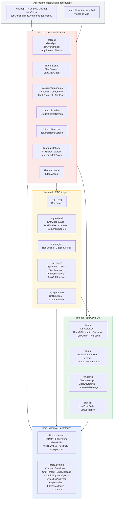
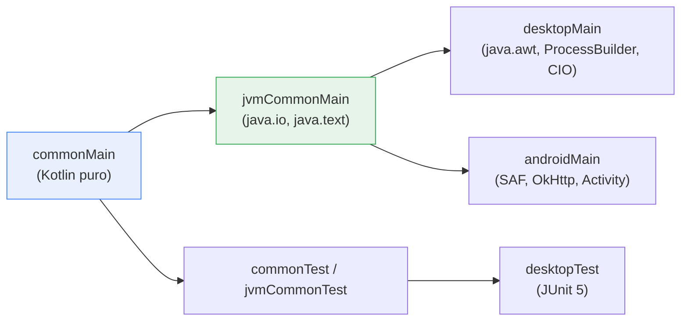
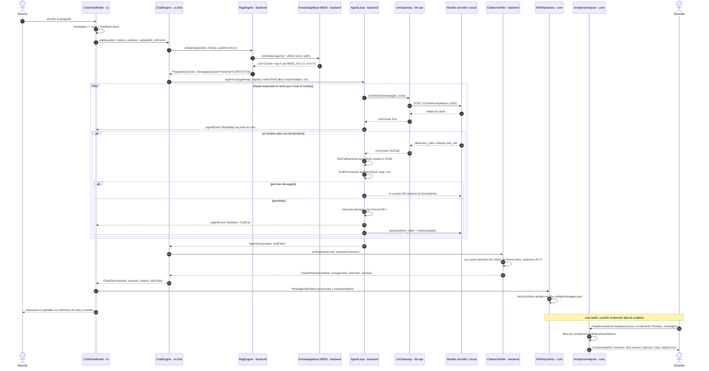
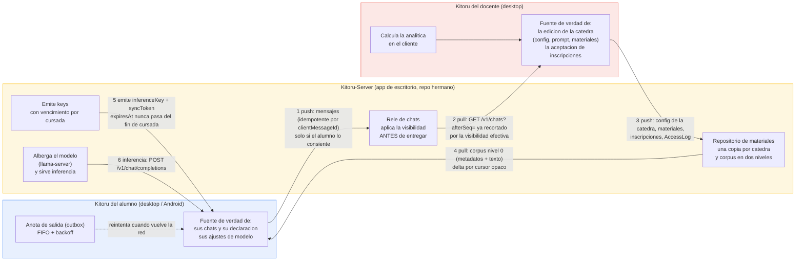

# 05 — Arquitectura de Kitoru

> **Qué es este documento.** La arquitectura **final** de Kitoru: qué es la app,
> cómo se reparte el código entre los módulos, qué pasa cuando un alumno hace
> una pregunta, cómo se sincronizan los tres actores, qué decisiones de diseño
> gobiernan todo el código y qué falta para que el primer hito funcione.
>
> **Estado**: arquitectura de referencia, síntesis sobre el código **real ya
> construido** (verificado en el repo el 2026-10-21) y los documentos de diseño
> de `docs/design/`.
>
> **Fuentes leídas**:
> `docs/design/CONTEXTO.md` · `docs/design/domain/{01-catedra,03-inscripciones,04-conversaciones,05-modelo-config,08-permisos}.md` ·
> `docs/design/analytics/{01-pipeline,02-metricas}.md` · `docs/design/platform/{01-local-android,03-kitoru-server-api}.md` ·
> `docs/design/rag/{02-chunking,03-calidad-recuperacion}.md` · `docs/design/process/02-roadmap.md` ·
> `docs/design/security/03-threat-model.md` · `docs/design/sync/01-contrato.md` ·
> el código de `:core`, `:llm-api`, `:backend`, `:ui` y los `build.gradle.kts` de todos los módulos ·
> y `C:/Users/gianf/Desktop/Projects/FunshiEngineAI` (origen de los ports).
>
> **Reglas del proyecto que esta arquitectura respeta** (de `CONTEXTO.md`):
> *reutilizar no reescribir* · *portable por defecto* · *determinista* ·
> *fail-fast con mensajes en español* · *el estudiante conserva agencia* ·
> *el docente no ve lo que no debe*.
>
> Cuando un documento de diseño y el código actual discrepan, este documento
> describe **el código actual** y anota la deuda en §9.

---

## 0. Resumen en una pantalla

| Módulo | Paquete raíz | Qué es | Estado |
|---|---|---|---|
| `:core` | `kitoru.platform` + `kitoru.domain` | El dominio puro y las costuras de plataforma. | ✅ construido, **sin tests** |
| `:llm-api` | `llm.api` / `llm.config` / `llm.error` | El contrato con el modelo y el cliente HTTP. | ✅ construido, **sin tests** |
| `:backend` | `rag.config` / `rag.retrieval` / `rag.engine` / `rag.agent` | RAG (BM25), verificador de citas y bucle de herramientas. | ✅ construido, **8 tests** |
| `:ui` | `kitoru.ui` (+ `.chat`, `.components`, `.student`, `.teacher`, `.platform`, `.theme`) | Compose Multiplatform: navegación, chat, pantallas. | 🟡 parcial (en construcción) |
| `:desktop` | `com.funshiengine.kitoru.desktop` | Entry point de escritorio (Compose Desktop). | ❌ **no existe** (está en `settings.gradle.kts`) |
| `:android` | `com.funshiengine.kitoru.android` | App Android. | ❌ **no existe** (está en `settings.gradle.kts`) |

Dependencias: `:core` ← `:llm-api` ← `:backend` ← `:ui` ← `:desktop` / `:android`.
**Nunca al revés.** No hay ciclos.

---

## 1. La visión y los dos roles

### 1.1 La visión, en un párrafo

**Kitoru es el aula con IA de una cátedra, en el dispositivo del alumno.** El
docente diseña la cátedra: sube el material, fija la configuración base del
modelo y escribe las instrucciones del tutor. El alumno se inscribe con un
código, chatea contra un modelo que responde **sólo** con el material de la
cátedra y **cita sus fuentes** con `[n]`, y cada respuesta se verifica de
forma determinista contra el fragmento que dice respaldarla. Con esos datos el
docente ve, por alumno y por cátedra, **cómo se usa la herramienta y qué tan
buenas son las respuestas** — sin depender de la opinión de un modelo ni de
ningún servicio externo que guarde lo que el alumno escribe. Todo corre en el
dispositivo: la app es *local-first*, el modelo puede ser el de la institución
o uno local del alumno, y lo que el docente ve está gobernado por una regla de
visibilidad que el alumno declara y el servidor aplica.

### 1.2 Los dos roles (y por qué no son un flag)

El rol **no es un atributo de la persona**: es un atributo de su **inscripción**
a una cátedra (`Enrollment.role`). Una misma persona puede ser `TITULAR` en
"Inteligencia Artificial" y `ALUMNO` en "Matemática Discreta" en la misma
instalación. Por eso la app no pregunta "¿sos docente?" para siempre: hace una
sola pregunta al entrar (`AppScreen.RolePicker`) y después cada pantalla se
decide por las inscripciones reales.

| | **Alumno** (`CourseRole.ALUMNO`) | **Docente** (`TITULAR` / `AYUDANTE`) |
|---|---|---|
| Qué diseña | Nada. Usa. | La cátedra: materiales, prompt, configuración base del modelo, padrón. |
| Qué consume | El modelo de la cátedra (ajustable) + el material de la cátedra. | La analítica de uso y calidad + los chats (según visibilidad). |
| Qué controla | Su **visibilidad** (su techo de compartir) y sus **ajustes de modelo** (dentro de los límites). | El **techo de visibilidad** por alumno (`visibilityCap`) y los **bloqueos** de campos del modelo. |
| Modelo local | Permitido si `Course.allowLocalModels`. En LOCAL sus chats **no salen de la máquina**. | No aplica. |
| Lo que ve de los demás | Nada. | Texto de los chats según `ChatVisibility`; métricas según la misma regla. |

Reglas que gobiernan el modelo de roles (de `domain/Roles.kt` y
`domain/08-permisos.md`):

- `CourseRole.canDesign` → `TITULAR` o `AYUDANTE` (materiales y prompt).
- `CourseRole.canConfigureModel` → sólo `TITULAR` (configuración base y bloqueos).
- `ChatVisibility` gobierna **qué ve el docente**: `FULL` (texto), `METRICS_ONLY`
  (sólo estadísticas y calidad) y `NONE` (nada).
- La **agencia del alumno** manda: `ModelPolicy.resolveFor(studentChoice)`
  aplica la base de la cátedra y respeta lo que el alumno cambió, salvo los
  campos en `lockedFields`.

---

## 2. Diagrama de módulos



**Reglas que impone el grafo:**

1. **`:core` no depende de nadie.** Es el único módulo que puede depender de
   `kotlinx-serialization` y `kotlinx-coroutines` y nada más.
2. **`:llm-api` depende de `:core`** (para `kitoru.platform.ioDispatcher` y
   `stripDiacritics`), nunca al revés.
3. **`:backend` depende de `:llm-api` y `:core`**; es donde vive el RAG.
   `ToolSpec` vive en `llm-api` (no en `backend`) porque el gateway la
   serializa en el body `tools[]`.
4. **`:ui` depende de los tres** y es el único que conoce Compose.
5. **`:desktop` y `:android` son sólo shells**: composition root, `KitoruPaths.setDataDir(...)`,
   construcción de repositorios y `KitoruApp(vm)`. Si algún día un módulo
   bajo importa Compose, es un bug de arquitectura.

### 2.1 El grafo de source sets (por qué `jvmCommonMain` existe)



`kotlin.mpp.applyDefaultHierarchyTemplate=false` en `gradle.properties` y los
source sets manuales de cada `build.gradle.kts`:

```kotlin
val jvmCommonMain by creating { dependsOn(commonMain) }
desktopMain.dependsOn(jvmCommonMain)
androidMain.dependsOn(jvmCommonMain)
```

**Por qué:** `java.io.File` y `java.text.Normalizer` existen en **las dos**
plataformas (Android desde la API 1), pero `java.nio.file` sólo desde la API 26
y `minSdk = 24`. Un source set intermedio permite reutilizar el 90 % del código
de plataforma sin arrastrar `java.nio.file` al target mínimo. Es la diferencia
entre un `commonMain` realmente portable y uno que "compila en Android pero
falla en runtime en dispositivos viejos".

---

## 3. El flujo de una pregunta



**Los cinco momentos que importan y por qué están donde están:**

| # | Momento | Dónde vive | Por qué ahí |
|---|---|---|---|
| 1 | Recuperación | `rag.retrieval.Bm25Index` | Determinista, sin red, sin modelo. La calidad se puede medir. |
| 2 | Recuperación + contexto | `rag.engine.RagEngine.prepare` | Arma `system + historial + CONTEXTO + PREGUNTA`. El prompt del sistema es una **lambda** (`systemPrompt: () -> String`) para que el docente lo edite sin reiniciar. |
| 3 | Herramientas | `rag.agent.AgentLoop` | Un solo bucle para los dos modos (nativo OpenAI y bloque ```` ```tool_call ```` por prompt), con sanitización, permisos y topes. |
| 4 | Verificación | `rag.engine.CitationVerifier` | **Puro**: sin red, sin modelo, sin reloj. Es lo que convierte "el modelo dijo" en un número reproducible. |
| 5 | Persistencia + analítica | `core.domain` | El mensaje guarda lo necesario (`sources`, `citation`, `toolCalls`, `latencyMs`, `tokens*`) para que la analítica **nunca** vuelva a mirar el texto. |

---

## 4. La sincronización: los tres actores



### 4.1 Qué viaja por cada flecha

| Flecha | Sentido | Qué viaja | Regla |
|---|---|---|---|
| 1 | alumno → servidor | `ChatThread` + `ChatMessage` (texto, fuentes, citas, tools, latencia, tokens), idempotente por `clientMessageId` | **Nunca automático** si el modelo es local: es un acto explícito del alumno ("Compartir mis conversaciones"), con consentimiento por paquete. |
| 2 | servidor → docente | Los chats **ya recortados**: el servidor calcula `min(tope del rol del observador, visibilityCap del alumno, visibility declarada)` y si el resultado es `METRICS_ONLY` el texto **no sale del servidor** | Defensa en profundidad: el docente no recibe texto que no puede ver, aunque el cliente falle. |
| 3 | docente → servidor | Configuración de la cátedra, materiales (metadata + binario), cambios del padrón, `AccessLog` | El servidor es la fuente de verdad *publicada*; el cliente del docente sigue siendo editable offline. |
| 4 | servidor → alumno | Corpus de la cátedra: **nivel 0** (metadata + texto extraído, ~1,4 MB) y **nivel 1** (binario original) sólo bajo demanda | El nivel 1 nunca se descarga en la primera sincronización (500 alumnos × 200 MB = 100 GB de egreso). |
| 5 | servidor → alumno | `inferenceKey` (permiso de consumo) y `syncToken` (sincronización) | **Dos tokens distintos**: la API key es un permiso de consumo, no una identidad. `expiresAt` nunca pasa del fin de la cursada. |
| 6 | servidor → alumno | La inferencia: `POST /v1/chat/completions` (SSE, tool-calling, `usage`) | El alumno puede usar el modelo del servidor **o** el local; si usa el local, la flecha 1 no existe para esas conversaciones. |

### 4.2 Las reglas que hacen que la visibilidad sea estructural

1. **El alumno es la fuente de verdad de sus conversaciones** y de su
   declaración de visibilidad. El servidor sólo relay y filtra.
2. **El servidor nunca afirma "este alumno no usó IA"**: afirma *"no usó la IA
   de la institución"* (evidencia dura) y *"declaró que usa IA local"*
   (evidencia blanda). La IA local es invisible por definición.
3. **La analítica no la calcula el servidor**: la calcula el cliente del docente
   con `AnalyticsAnalyzer.analyze` (función pura ya existente). Una sola
   implementación, determinista y testeable; el servidor queda tonto.
4. **El docente tiene credenciales de servicio separadas** del alumno: los
   chats se entregan por *pull* (`GET /v1/chats?afterSeq=`), no por push, porque
   la app del docente suele estar detrás de NAT.

Detalle completo del contrato: `docs/design/sync/01-contrato.md` (KSP/1) y
`docs/design/platform/03-kitoru-server-api.md`.

---

## 5. Mapa de paquetes

### 5.1 `:core` — dominio y plataforma

| Paquete / archivo | Contenido | Responsabilidad (una línea) |
|---|---|---|
| `kitoru.platform` · `FileSystem.kt` | `FilePath`, `FileSystem`, `expect fun systemFileSystem()` | La costura de E/S: rutas opacas y una interfaz de archivos mínima (9 operaciones). |
| `kitoru.platform` · `KitoruPaths.kt` | `KitoruPaths` | La raíz de datos de la app (`dataDir`, `configDir`, `coursesDir`, `cacheDir`); la fija la app al arrancar. |
| `kitoru.platform` · `Text.kt` | `expect fun stripDiacritics`, `expect fun nowMillis` | Normalización de texto (base del BM25 y del verificador) y reloj del sistema. |
| `kitoru.platform` · `Dispatchers.kt` | `expect val ioDispatcher` | El dispatcher de E/S, expuesto desde `commonMain` para que la red no sepa dónde corre. |
| `kitoru.platform` (jvmCommonMain) | `JvmFileSystem`, `Dispatchers.IO` | Implementación JVM sobre `java.io.File` + `java.text.Normalizer`. |
| `kitoru.domain` · `Roles.kt` | `CourseRole`, `UserProfile`, `ChatVisibility` | Quién es, qué puede hacer y qué ve el docente de cada chats. |
| `kitoru.domain` · `Course.kt` | `Course`, `Enrollment`, `MaterialKind`, `Material` | La cátedra, el padrón y el corpus. |
| `kitoru.domain` · `ModelPolicy.kt` | `ModelMode`, `LockedField`, `ModelPolicy` | La configuración base del modelo, los bloqueos y `resolveFor(studentChoice)`. |
| `kitoru.domain` · `Chat.kt` | `ChatThread`, `ChatMessage`, `CitationStats`, `ToolCallStats` | La conversación y **los datos de calidad que la analítica necesita**. |
| `kitoru.domain` · `Analytics.kt` | `StudentAnalytics`, `CourseAnalytics`, `DayActivity`, `SourceUsage` | El contrato de métricas que ve el docente. |
| `kitoru.domain` · `AnalyticsAnalyzer.kt` | `AnalyticsAnalyzer` | El cálculo de la analítica: **función pura**, sin disco, sin red, sin reloj. |
| `kitoru.domain` · `Repositories.kt` | 6 interfaces de repositorio | Los contratos de persistencia (para que mañana sea un servidor y no toque la UI). |
| `kitoru.domain` · `FileRepositories.kt` | `FileBackedRepository<T>` + 6 implementaciones | Persistencia local sobre JSON, un archivo por tipo en `config/`. |
| `kitoru.domain` · `JsonStore.kt` | `KitoruJson`, `JsonStore<T>`, `JsonListStore<T>` | Lectura/escritura JSON serializada con `Mutex`; un archivo roto **no** voltea la app. |

### 5.2 `:llm-api` — el contrato con el modelo

| Paquete / archivo | Contenido | Responsabilidad |
|---|---|---|
| `llm.api` · `LlmGateway.kt` | `LlmGateway`, `OpenAiCompatibleGateway` | El contrato (`chatStream`/`chatText`/`chat`/`listModels`/`close`) y el cliente SSE contra `/v1/chat/completions`. |
| `llm.api` · `Tools.kt` | `ToolSpec`, `LlmChunk` | El catálogo de herramientas y el streaming **tipado** (`Text` \| `ToolCall`). |
| `llm.api` · `LocalModelService.kt` | `LocalModelService`, `expect fun createLocalModelService()` | El seam del modelo local: `start()` devuelve un `LlmGateway`. |
| `llm.config` · `ChatMessage.kt` | `ChatMessage` | El mensaje en formato OpenAI (`tool_calls`, `tool_call_id`, `name`). |
| `llm.config` · `GatewayConfig.kt` | `GatewayConfig`, `LocalModelSettings` | El puente entre el dominio (`ModelPolicy`) y la red; y los parámetros del modelo local. |
| `llm.error` · `LlmErrors.kt` | `LlmErrorCode`, `LlmException` | Errores tipados con `retryable`: la UI decide sin parsear texto. |

### 5.3 `:backend` — RAG, verificador y agente

| Paquete / archivo | Contenido | Responsabilidad |
|---|---|---|
| `rag.config` · `RagConfig.kt` | `RagConfig` | Los parámetros del RAG **por cátedra** (chunk 1200, overlap 150, topK 5, historial 6). |
| `rag.retrieval` · `Models.kt` | `Doc`, `Chunk` | Las dos unidades del RAG. |
| `rag.retrieval` · `Bm25Index.kt` | `Bm25Index` | El índice BM25 en memoria + el tokenizador (sin dependencias, sin embeddings). |
| `rag.retrieval` · `Chunker.kt` | `Chunker` | Trocea por encabezados Markdown y luego por tamaño, con solapamiento. |
| `rag.retrieval` · `DocumentSource.kt` | `DocumentSource`, `CourseMaterialSource`, `InMemorySource` | De dónde salen los documentos: **la cátedra** (los materiales del docente). |
| `rag.retrieval` · `KnowledgeBase.kt` | `KnowledgeBase` | Carga → trocea → indexa → recupera. Fuentes reindexables en caliente. |
| `rag.engine` · `RagEngine.kt` | `RagEngine`, `Prepared` | Arma el prompt con el CONTEXTO y expone `verify()`. |
| `rag.engine` · `CitationVerifier.kt` | `CitationVerifier`, `CitationReport`, `CitationCheck`, `KeyTerm` | La comprobación determinista de citas: literal → sin detalles inventados → paráfrasis (≥ 50 %). |
| `rag.agent` · `Tool.kt` | `Tool`, `ToolCategory`, `ToolOrigin`, `ToolContext`, `ToolResult`, `Artifact`, `PermissionRequest`, `PermissionDecision` | El contrato de herramienta y el contexto de permisos. |
| `rag.agent` · `ToolRegistry.kt` | `ToolRegistry` | Las herramientas disponibles; mutable para el descubrimiento en caliente de MCP. |
| `rag.agent` · `ToolPermissions.kt` | `ToolPermissions.authorize` | Permiso **por categoría**, apagado por defecto, concedido por chat. |
| `rag.agent` · `ToolCallSanitizer.kt` | `ToolCallSanitizer`, `SanitizedToolCall` | Repara el JSON que mandan los modelos chicos; si no puede, devuelve el motivo como feedback. |
| `rag.agent` · `AgentLoop.kt` | `AgentLoop`, `AgentEvent`, `AgentAnswer`, `ExecutedTool`, `PromptToolParser` | El bucle de tool-calling, en modo nativo y en modo prompt. |
| `rag.agent.tools` · `GetTimeTool.kt` | `GetTimeTool` | Herramienta de prueba del bucle (permiso `NONE`). |
| `rag.agent.tools` · `CreateFileTool.kt` | `CreateFileTool` | El modelo crea un archivo de texto/código **dentro** de `outputs/<chatId>/` (permiso `FILES`). |

### 5.4 `:ui` — Compose Multiplatform

| Paquete / archivo | Contenido | Responsabilidad |
|---|---|---|
| `kitoru.ui` · `KitoruApp.kt` | `KitoruApp`, `RolePickerScreen` | La raíz: decide qué pantalla se ve según `AppScreen`. |
| `kitoru.ui` · `KitoruViewModel.kt` | `AppScreen`, `KitoruViewModel` | El estado raíz y la navegación (pila manual) + las vistas derivadas del rol. |
| `kitoru.ui` · `Theme.kt` | `KitoruTheme` | El tema Material 3 de Kitoru. |
| `kitoru.ui.theme` · `KitoruAccent.kt` | paleta | El acento de color. |
| `kitoru.ui.chat` · `ChatEngine.kt` | `ChatEngine`, `ChatOutcome` | El circuito `preparar → preguntar → verificar` y la política de `ModelPolicy` resuelta. |
| `kitoru.ui.chat` · `ChatViewModel.kt` | `ChatViewModel`, `UiChatMessage` | El estado del chat: streaming en vivo, cola de mensajes, permiso de herramienta. |
| `kitoru.ui.components` · `Markdown.kt` | `parseMarkdown`, `MarkdownText` | El renderizador de Markdown propio (sin `richtext`). |
| `kitoru.ui.components` · `CodeBlock.kt` | `CodeBlock` | Bloques de código con copiado y resaltado. |
| `kitoru.ui.components` · `MathSegment.kt` | `splitMath` | Segmentación de LaTeX dentro del texto. |
| `kitoru.ui.components` · `ChatParts.kt` | `CitationBadge`, `SourceList`, `ToolCallRow` | Las piezas que hacen visible la calidad: distintivo de citas, fuentes, tarjetas de herramientas. |
| `kitoru.ui.student` · `StudentHomeScreen.kt` | `StudentHomeScreen`, `StudentModelScreen`, `StudentMaterialsScreen` | Las pantallas del alumno. |
| `kitoru.ui.teacher` · `TeacherHomeScreen.kt` | `TeacherHomeScreen`, `TeacherCourseScreen`, `TeacherAnalyticsScreen`, `TeacherMaterialsScreen`, `TeacherChatsScreen`, `TeacherStudentsScreen` | Las pantallas del docente. |
| `kitoru.ui.platform` · `FileSaver.kt` | `FileSaver`, `expect fun rememberFileSaver()` | El seam de "guardar como": `java.awt.FileDialog` en desktop, SAF en Android. |

### 5.5 Las apps (todavía inexistentes)

| Módulo | Responsabilidad | Estado |
|---|---|---|
| `:desktop` | Composition root de escritorio: `KitoruPaths.setDataDir(~/.kitoru)`, repositorios `File*`, `KitoruApp(vm)`, ventana Compose. `ui/build.gradle.kts` ya apunta a `com.funshiengine.kitoru.desktop.MainKt`. | ❌ falta el directorio y el `build.gradle.kts` |
| `:android` | Composition root de Android: `KitoruPaths.setDataDir(context.filesDir/kitoru)`, `Activity` Compose, SAF. | ❌ falta el directorio y el `build.gradle.kts` |

---

## 6. Decisiones de arquitectura

> Formato: **Decisión → Por qué → Alternativa descartada → Coste**.

### D1 · Portable por defecto: `commonMain` es Kotlin puro

**Decisión.** `commonMain` no importa nada de `java.*` ni de `android.*`.
Todo lo específico de plataforma vive en `desktopMain` / `androidMain` /
`jvmCommonMain`, detrás de interfaces (`FileSystem`, `LocalModelService`,
`FileSaver`) o de `expect/actual`.

**Por qué.** Kitoru tiene que vivir en un teléfono y en un portátil, y el
material de la cátedra y los chats del alumno son datos institucionales: la
app no puede depender de una API que no exista en `minSdk = 24`.

**Alternativa descartada.** Usar `java.nio.file.Path` directamente (lo que
hace FunshiEngineAI): `java.nio.file` existe en Android **desde la API 26** y
Kitoru declara `minSdk = 24`. Habría que subir el `minSdk` o usar `flavors`.

**Coste.** Una indirección más (`FilePath` es opaca, no tiene `resolve` contra
el sistema). Se paga una sola vez y se recupera en el `CreateFileTool`, que
escribe igual en las dos plataformas.

### D2 · BM25 y no embeddings

**Decisión.** La recuperación es BM25 en memoria
(`rag.retrieval.Bm25Index`, `k1 = 1.5`, `b = 0.75`) con tokenización propia
(camelCase partido, minúsculas, sin diacríticos, stop-words ES+EN).

**Por qué.** Es **determinista**, gratis, sin GPU, sin modelo que descargar y
sin dependencia nativa: funciona igual en el escritorio, en Android y en el
servidor. Y es lo que hace medible el sistema: con la misma consulta da el
mismo `top-K` siempre, así que el benchmark de `rag/03` es reproducible.

**Alternativa descartada.** Embeddings densos (o reranking por LLM): forman
el archivo de índices, agregan una dependencia nativa (ONNX/TensorFlow) y
miles de millones de operaciones por consulta. Además, `rag/03` D9 argumenta que
el reranking por LLM cuesta **+5–30 s de latencia** con modelos locales y es
peor que BM25 en el rango 5–10.

**Coste.** El recall en español técnico es peor que con embeddings (plurals,
formas verbales, sinónimos). Está asumido y medido: la mitigación es el
**stemmer español ligero** sin dependencias (rag/03 D8), aplicado simétricamente
a índice y consulta, más la PRF determinista. El costo oculto: `topK` es un
**presupuesto de tokens**, no un número libre — con `chunkSize = 1200`,
`topK = 5` son ~2.000 tokens de contexto.

### D3 · Verificador de citas determinista

**Decisión.** `rag.engine.CitationVerifier` comprueba **programáticamente**
que cada cita `[n]` de la respuesta esté respaldada por la fuente `n`. Tres
criterios en orden: (1) literal; (2) sin detalles inventados (todo nombre
propio o número de ≥ 2 dígitos del fragmento citado tiene que estar en la
fuente); (3) paráfrasis honesta (≥ 50 % de las palabras significativas
aparecen, con coincidencia por raíz común de ≥ 5 letras).

**Por qué.** Con un modelo chico, "respondé sólo con el CONTEXTO y citá" es
una instrucción blanda: parafrasea, exagera e inventa. El verificador
convierte la instrucción en una **comprobación**. Y al ser una función pura,
el docente ve un número reproducible y el benchmark se puede armar sin gastar
tokens.

**Alternativa descartada.** (a) Un *juez* LLM que califique las respuestas:
cuesta tokens, no es determinista y no se puede testear. (b) Confiar en el
`usage`/`citations` del proveedor: la mayoría de los gateways OpenAI-compatible
no lo dan. (c) embeddings para medir la similitud entre cita y fuente: una
cita paráfraseada pero correcta se marcaría como inventada, y una cita literal
con un número cambiado se marcaría como buena.

**Coste.** Falsos positivos y negativos: el verificador juzga **la frase que
lleva el marcador**, no la respuesta entera; una respuesta sin ninguna cita no
cuenta como "sin respaldo" en la analítica actual (agujero #4 del threat
model). Además, el test portado de FunshiEngineAI fija que una cita sin texto
alrededor ("Sí [1].") cuenta como respaldada: es correcto para la UI y
**no** sirve como evidencia para armar un gold set (rag/03 H3).

### D4 · El modelo de visibilidad: la visibilidad es un dato de la inscripción

**Decisión.** `ChatVisibility` (`FULL` / `METRICS_ONLY` / `NONE`) vive en
`Enrollment.visibility` — **lo declara el alumno** — y se aplica en tres
lugares: el filtro de `AnalyticsAnalyzer.analyze`, el recorte del servidor
antes de entregarle los chats al docente, y la UI del explorador de chats.

**Por qué.** La regla de `CONTEXTO.md` es "el docente no ve lo que no debe: la
visibilidad por inscripción es la regla, no una excepción". Con IA local, el
texto **nunca sale de la máquina del alumno**: no es un permiso que se pueda
aplicar, es una ausencia de datos. La visibilidad es lo que traduce esa
ausencia en algo que el docente puede ver sin invadir.

**Alternativa descartada.** (a) Que el servidor decida por configuración de la
cátedra: contradice la agencia del alumno y hace que el modo local sea
invisible. (b) Que el docente vea todo y confíe en que no mira: es exactamente
la falla que el enunciado prohíbe.

**Coste.** Es **un solo eje** hoy (`visibility`). El diseño `domain/03`
redefine dos ejes (`visibility` del alumno + `visibilityCap` del docente) más
un tope por rol del observador (`VisibilityPolicy`), y `domain/08` lo lleva a
un `Capability` por acción. El código actual no lo tiene: es **deuda
documentada** (§9). Mientras tanto, el tope por rol y el `visibilityCap`
quedan sin implementar.

### D5 · El seam de `FileSystem`: una interfaz mínima, no `Path`

**Decisión.** `kitoru.platform.FileSystem` con 9 operaciones (`exists`,
`isDirectory`, `sizeBytes`, `readText`, `writeText`, `delete`,
`createDirectories`, `listFiles`, `copy`) y `FilePath` como **ruta opaca**
(`value`, `name`, `extension`, `parent`, `resolve`, `relativeTo`).

**Por qué.** Es lo que permite testear los repositorios **sin disco** (con un
`InMemoryFileSystem`, que todavía no existe) y lo que mantiene a
`domain/` libre de E/S. `FilePath` no se puede "usar" como ruta real: obliga a
pasar por `FileSystem`.

**Alternativa descartada.** `okio` (`FileSystem`/`Path` de Okio): agrega una
dependencia de terceros a `:core` por algo que `java.io.File` ya resuelve en
las dos plataformas.

**Coste.** Falta `readBytes`/`writeBytes` (para subir un PDF) y `rename`
(para escrituras atómicas). Y `FilePath` duplica un subconjunto de `Path`:
si algún día se necesita algo más, la interfaz crece.

### D6 · `expect/actual` sólo donde hace falta: 6 seams en todo el proyecto

**Decisión.** Seis declaraciones `expect` en todo el repo, todas justificadas
por una diferencia real entre las plataformas.

**Por qué.** Cada `expect` es una decisión que se paga cada vez que se cambia
la app: un `expect` de más es unauzz misma dos veces. Y un `expect` de menos
es una `ClassCastException` en runtime.

**Alternativa descartada.** Un "adaptador de plataforma" único con 30 métodos
(o peor: un singleton `Platform` con `if (isAndroid)`): mezcla todo en un
archivo y esconde las diferencias detrás de ifs.

**Coste.** Ninguno relevante: son 6 y el juego está payoff. La tabla completa
está en §7.

### D7 · Módulos con dependencias estrictamente descendentes

**Decisión.** `:core` → `:llm-api` → `:backend` → `:ui` → `:desktop`/`:android`.
Nunca al revés, nunca ciclos.

**Por qué.** Cada módulo tiene una razón para existir: `:core` (regla de
negocio), `:llm-api` (el modelo), `:backend` (RAG + agente), `:ui` (presentación).
El gradiente de dependencias es el diagrama: si algo no encaja, es que el
módulo está mal.

**Alternativa descartada.** Un solo módulo `app` con todos los paquetes: se
puede, pero entonces nada obliga a que `domain` no dependa de Compose, y
`commonMain` se rompe en el primer `import androidx…`.

**Coste.** Build más lento (5 módulos en vez de 1) y un poco de ceremonia en
los `build.gradle.kts` (los source sets manuales se repiten). A cambio, un
`import` prohibido es un error de compilación, no una architectural review.

### D8 · Local-first: el servidor sincroniza, no almacena

**Decisión.** Los datos del alumno (chats, materiales, índice, ajustes) viven
en el dispositivo. El Kitoru-Server es el que aloja el modelo, emite keys y
relé chats; **no** es la base de datos de la app.

**Por qué.** Kitoru tiene que funcionar en un avión, sin red, y con la IA
local. Y "local-first" es lo que hace que el modo LOCAL del alumno sea
posible en absoluto.

**Alternativa descartada.** App cliente fina contra el servidor: la app deja
de funcionar sin servidor, y el "el servidor no ve los chats" se vuelve
imposible de garantizar.

**Coste.** Hay que escribir el cliente de sincronización (no existe todavía),
manejar cursores opacos, outbox, conflictos y reintentos: es la fase F9, la
más grande después de la UI.

### D9 · La analítica se calcula en el cliente, con una función pura

**Decisión.** `AnalyticsAnalyzer.analyze(course, enrollments, threads, messages)`
es una **función pura**: no toca disco, no llama al modelo, no depende de la
red ni del reloj (el reloj se pasa como `createdAt` de los mensajes). El
servidor no calcula analítica.

**Por qué.** Es la regla 3 de `CONTEXTO.md` ("la analítica no puede depender
del modelo ni de la red"). Y una función pura es 100 % testeable y
**reproducible**: el docente ve los mismos números siempre.

**Alternativa descartada.** (a) SQL en el servidor: agrega una base de datos y
duplica la lógica en dos lenguajes. (b) Cachear la analítica en el servidor:
el resultado depende del momento en que se calcula.

**Coste.** `analyze` es **O(S·M)**: con 500 alumnos y 1 M de mensajes son
30–60 s en escritorio y 2–4 min en Android, y ~1 GB de RAM. El diseño
`analytics/01` lo reemplaza por un `AnalyticsAccumulator` incremental con
`analyze` como fachada; ese acumulador **todavía no existe** (§9).

### D10 · La configuración del modelo es **base + deltas**, y la base la impone la cátedra

**Decisión.** `ModelPolicy` es la **base** de la cátedra; el alumno puede
ajustarla salvo en los campos de `lockedFields`; `resolveFor(studentChoice)`
aplica los bloqueos y devuelve la configuración efectiva.

**Por qué.** Es la regla 5 de `CONTEXTO.md`: "el estudiante conserva agencia".
El modelo de dominio tiene que poder expresar "la cátedra pone la base, el
alumno ajusta" **declarativamente**, para que la UI sea trivial.

**Alternativa descartada.** (a) Sin bloqueo: el alumno puede cambiar la URL y
mandar la clave de la institución a donde quiera. (b) Bloqueo total: el alumno
pierde la agencia y no puede, por ejemplo, subir la temperatura para una
pregunta difícil.

**Coste.** Hoy `Set<LockedField>` es **todo-o-nada**: no puede expresar "la
temperatura puede ir entre 0 y 0.8" ni "el modelo tiene que ser uno de estos
tres". El diseño `domain/05` lo reemplaza por `Map<LockedField, FieldConstraint>`
con `Free` / `Ranged` / `Choice` / `Locked` más un `StudentModelProfile` que
guarda **deltas**, no una copia de la política. Eso **no** está implementado
(§9): hoy el alumno copia la `ModelPolicy` entera, lo que incluye la API key
en `ChatThread.effectiveModel` (agujero de seguridad #1).

### D11 · Un solo `AgentLoop` para los dos modos de tool-calling

**Decisión.** `AgentLoop(gateway, registry, nativeToolCalls, toolTimeoutMs)`
soporta (a) tool-calling **nativo** del protocolo OpenAI (REMOTE) y (b) un
protocolo por **prompt** con bloque delimitado ```` ```tool_call ```` (LOCAL,
para modelos chicos como Phi-4-mini que no emiten `tool_calls`).

**Por qué.** El mismo bucle, las mismas reglas de sanitización, permisos y
topes, en los dos modos: no hay dos implementaciones que diverjan. Y el modo
por prompt es el único que funciona con los modelos locales, que son
precisamente el modo "el alumno no depende de la institución".

**Alternativa descartada.** Dos motores (uno nativo, otro "parsear el texto"):
más código, reglas duplicadas y divergencias garantizadas.

**Coste.** El parser por prompt es **line-buffered**: el texto visible se
emite por líneas, no por token (el modo nativo sigue por token). Con un modelo
chico es aceptable; con uno grande, una diferencia perceptible de latencia
visual.

### D12 · Navegación manual (pila de `AppScreen`) en vez de `navigation-compose`

**Decisión.** `kitoru.ui.AppScreen` es un `sealed class` y
`KitoruViewModel.screen` es un `mutableStateOf`; `back()` codifica a mano a
dónde se vuelve.

**Por qué.** `navigation-compose` **no es multiplataforma** en Compose
Multiplatform 1.7.3. Y el árbol de pantallas de Kitoru es chico (11
pantallas) y muy_role-dependent.

**Alternativa descartada.** `navigation-compose` + `NavHost` con rutas: la
dependencia no es multiplataforma hoy, y el `ViewModel` de Android tampoco
existe en el target común (por eso `KitoruViewModel` es una clase plana, no
un `androidx.lifecycle.ViewModel`).

**Coste.** No hay deep links, ni pila de back real, ni restauración de estado.
Se acepta en el MVP; si aparece el requirement, se migra a una pila propia
(que es lo que ya es `back()`).

### D13 · El `system prompt` de la cátedra viaja como lambda

**Decisión.** `RagEngine(cfg, kb, llm, systemPrompt: () -> String)`: el prompt
se evalúa **en cada pregunta**, no se lee de un archivo.

**Por qué.** El docente edita el prompt desde la UI; si estuviera cacheado o
leído de disco, haría falta reiniciar la app para que el cambio se viera.
Además, con una lambda el prompt puede venir de la base de datos, del
servidor o de un test.

**Alternativa descartada.** Leer `system-prompt.md` del disco en cada pregunta
(lo que hace FunshiEngineAI): I/O por pregunta y sin conexión con el modelo de
dominio.

**Coste.** Una lambda por instancia de `RagEngine` — trivial. Pero obliga a
que `RagEngine` se reconstruya cuando cambia el prompt… salvo que se pase la
lambda, que es justo lo que hace.

### D14 · `KitoruPaths` con `dataDir` inyectado

**Decisión.** `KitoruPaths.dataDir` se fija con `setDataDir(path)` al arrancar
la app; `configDir`, `coursesDir` y `cacheDir` son derivados.

**Por qué.** El dominio no puede saber si está en `~/.kitoru` o en
`context.filesDir/kitoru`. Inyectarlo además hace trivial el test: apuntar a
un temporal.

**Alternativa descartada.** Rutas absolutas calculadas dentro de `domain`:
ataría `:core` a cada plataforma y rompería los tests.

**Coste.** Una fuente de verdad mutable global (`object`): si dos pruebas la
tocan a la vez, hay carrera. Se mitiga con un `InMemoryFileSystem` y sin
tocar `KitoruPaths` en los tests (deuda menor).

---

## 7. Los seams de portabilidad

**Todos** los `expect`/`actual` del repo. Son **6**.

| # | Seam | `expect` (commonMain) | `actual` (desktop) | `actual` (android) | Motivo |
|---|---|---|---|---|---|
| 1 | **Sistema de archivos** | `kitoru.platform.systemFileSystem(): FileSystem`<br/>`core/.../platform/FileSystem.kt` | `JvmFileSystem` sobre `java.io.File`<br/>`core/src/jvmCommonMain/.../FileSystem.jvm.kt` | *el mismo* (`jvmCommonMain`) | `java.io.File` existe desde la API 1; `java.nio.file` **no** (API 26). Un solo `actual` sirve a las dos plataformas. |
| 2 | **Normalización de texto** | `kitoru.platform.stripDiacritics(text: String): String`<br/>`core/.../platform/Text.kt` | `java.text.Normalizer` (NFD) + `Regex("\\p{M}+")`<br/>`core/src/jvmCommonMain/.../FileSystem.jvm.kt` | *el mismo* (`jvmCommonMain`) | Base del BM25 y del verificador de citas: "Definición" y "definicion" tienen que ser el mismo token. `java.text.Normalizer` está disponible en Android. |
| 3 | **Reloj** | `kitoru.platform.nowMillis(): Long`<br/>`core/.../platform/Text.kt` | `System.currentTimeMillis()`<br/>`core/src/jvmCommonMain/.../FileSystem.jvm.kt` | *el mismo* (`jvmCommonMain`) | `System.currentTimeMillis()` es portable; el seam existe para que el tiempo sea **inyectable** en los tests y para no arrastrar `java.time` al `commonMain`. |
| 4 | **Dispatcher de E/S** | `kitoru.platform.ioDispatcher: CoroutineDispatcher`<br/>`core/.../platform/Dispatchers.kt` | `Dispatchers.IO`<br/>`core/src/jvmCommonMain/.../Dispatchers.jvm.kt` | *el mismo* (`jvmCommonMain`) | Permite que `commonMain` (el gateway HTTP, el `KnowledgeBase.sync`) haga E/S sin saber dónde corre. |
| 5 | **Modelo local** | `llm.api.createLocalModelService(): LocalModelService`<br/>`llm-api/.../llm/api/LocalModelService.kt` | `LlamaServerLocalModelService` (proceso hijo `llama-server`)<br/>`llm-api/src/desktopMain/.../LocalModelService.desktop.kt` | `UnavailableLocalModelService` (lanza `LlmException(NO_CONFIGURADO)`)<br/>`llm-api/src/androidMain/.../LocalModelService.android.kt` | El motor local **existe sólo en escritorio**. En Android la alternativa real es un binding JNI in-process a llama.cpp (diseño `platform/01`), que es un hito posterior. |
| 6 | **Guardar archivo** | `@Composable kitoru.ui.platform.rememberFileSaver(): FileSaver`<br/>`ui/.../platform/FileSaver.kt` | `DesktopFileSaver` (`java.awt.FileDialog`)<br/>`ui/src/desktopMain/.../FileSaver.desktop.kt` | SAF `ACTION_CREATE_DOCUMENT`<br/>`ui/src/androidMain/.../FileSaver.android.kt` | Diálogo nativo vs. Storage Access Framework: en Android es la **única** forma soportada de escribir en una carpeta elegida por el usuario sin permisos invasivos. |

**Por qué son sólo 6 y no más.** Todo lo demás que habría sido un `expect` se
resolvió con una **interfaz** que se inyecta:

| Lo que "es de plataforma" | Cómo se resolvió en vez de con `expect/actual` |
|---|---|
| Escribir/leer archivos | Interfaz `FileSystem` + `expect fun systemFileSystem()` (1 sola vez). |
| Herramientas que usan archivos | `CreateFileTool(fs: FileSystem, maxBytes: Long)` — recibe la interfaz. |
| Descargar y guardar | Interfaz `FileSaver` (6) con `expect` **sólo** para instanciarla. |
| Configuración y caché | `KitoruPaths.dataDir` inyectado por la app (§D14). |
| HTTP | `LlmGateway` como interfaz; el motor Ktor (CIO/OkHttp) se resuelve por classpath, sin `expect`. |
| Reloj y texto | `expect` de una línea (2, 3) porque son el mínimo irreducible. |

**Lo que hay que agregar (y por qué es `expect` de verdad):**

| Seam futuro | Por qué necesita `expect` | Nota |
|---|---|---|
| Contexto de plataforma Android | `getExternalFilesDir` / `nativeLibraryDir` para el binding JNI de llama.cpp | Ya anticipado en `platform/01` §1.2: `expect fun createLocalModelService()` hoy **no recibe nada**. |
| Descarga del GGUF | HTTP con reanudación + `sha256` + control de espacio | El `HuggingFaceDownloader` de FunshiEngineAI es JVM puro; la versión Android necesita `Context`. |
| Notificaciones / lifecycle | `onTrimMemory`, foreground service | Sólo para la fase de IA local en Android. |
| Buscador de archivos (abrir) | `ACTION_OPEN_DOCUMENT` vs. `JFileChooser` | El `FileSaver` ya cubre sólo *guardar*; *abrir* es un seam espejo. |

---

## 8. El mapa de ports desde FunshiEngineAI

**Origen**: `C:\Users\gianf\Desktop\Projects\FunshiEngineAI` (commit `1ea46e2`
en `origin/main`, con 20 clases de test en `:backend` y 2 en `:llm-api`).
**Destino**: Kitoru, todo en Kotlin Multiplatform (`commonMain`).

**Regla aplicada** (`CONTEXTO.md` §Reglas 1 y 2): *reutilizar, no reescribir*;
portar con adaptaciones mínimas y documentadas, y **portable por defecto**.

### 8.1 `backend` → `backend`

| Origen | Destino | Cambio | Estado |
|---|---|---|---|
| `rag/retrieval/Bm25Index.kt` | `rag/retrieval/Bm25Index.kt` | `java.text.Normalizer` → `kitoru.platform.stripDiacritics` (se borra el `Regex` de marcas) | ✅ portado (idéntico salvo la normalización) |
| `rag/retrieval/Chunker.kt` | `rag/retrieval/Chunker.kt` | — (byte a byte) | ✅ portado literal |
| `rag/retrieval/Models.kt` | `rag/retrieval/Models.kt` | — (byte a byte) | ✅ portado literal |
| `rag/retrieval/KnowledgeBase.kt` | `rag/retrieval/KnowledgeBase.kt` | `githubSources` + `internalDocsDirs` + `motorDocsDir` → `sources: List<DocumentSource>`; `Dispatchers.IO` → `ioDispatcher`; `retrieve(query, k = cfg.topK)`; `isEmpty` nuevo | ✅ portado adaptado |
| `rag/retrieval/Sources.kt` (`GithubDocsSource`, `LocalDocsSource`) | `rag/retrieval/DocumentSource.kt` (`DocumentSource`, `CourseMaterialSource`, `InMemorySource`) | La fuente pasa a ser **la cátedra** (sus materiales), no repos de GitHub ni carpetas del motor | 🔄 reescrito |
| `rag/engine/RagEngine.kt` | `rag/engine/RagEngine.kt` | `systemPrompt` pasa a ser una **lambda inyectada** (en vez de leer `systemPromptFile` del disco); se eliminan `ask()` y `askGeneral()` (el flujo vive ahora en `:ui/chat/ChatEngine`); `AppPaths` fuera | ✅ portado adaptado |
| `rag/engine/CitationVerifier.kt` | `rag/engine/CitationVerifier.kt` | `java.text.Normalizer` → `stripDiacritics` | ✅ portado (algoritmo intacto) |
| `rag/agent/AgentLoop.kt` | `rag/agent/AgentLoop.kt` | — (byte a byte) | ✅ portado literal |
| `rag/agent/Tool.kt` | `rag/agent/Tool.kt` | `java.nio.file.Path` → `kitoru.platform.FilePath`; KDoc reducido a una línea por tipo | ✅ portado adaptado |
| `rag/agent/ToolRegistry.kt` | `rag/agent/ToolRegistry.kt` | — (byte a byte) | ✅ portado literal |
| `rag/agent/ToolPermissions.kt` | `rag/agent/ToolPermissions.kt` | — (byte a byte) | ✅ portado literal |
| `rag/agent/ToolCallSanitizer.kt` | `rag/agent/ToolCallSanitizer.kt` | — (byte a byte) | ✅ portado literal |
| `rag/agent/tools/GetTimeTool.kt` | `rag/agent/tools/GetTimeTool.kt` | `java.time.LocalDateTime` → `nowMillis()` + **algoritmo civil de Howard Hinnant** (sin `java.time` en `commonMain`); la hora pasa a ser UTC en vez de zona local | ✅ portado adaptado |
| `rag/agent/tools/FileTools.kt` (`CreateFileTool` + `DownloadUrlTool`) | `rag/agent/tools/CreateFileTool.kt` | Se conserva **sólo** `create_file`; `Path` → `FilePath`; `download_url` **no** se porta (necesita red y permisos de red en Android) | ⚠️ portado parcial |
| `rag/agent/tools/WebTools.kt` | — | No portado: requiere red pública y parseo de HTML | ❌ descartado |
| `rag/agent/tools/LatexTool.kt` | — | No portado: LaTeX → imagen necesita un motor externo (`latex`/dvisvgm) | ❌ descartado |
| `rag/mcp/*` (`McpConfig`, `McpManager`, `McpProtocol`, `McpStdioClient`, `McpToolAdapter`) | — | No portado: `ProcessBuilder` + JSON-RPC por stdio **no es portable** a Android. El contrato MCP remoto del Kitoru-Server lo reemplaza en F9 | ❌ descartado (con reemplazo previsto) |
| `rag/config/Config.kt` (global) | `rag/config/RagConfig.kt` | Global → **por cátedra**; sin `systemPromptFile`/`githubSources`/`internalDocsDirs`/`cacheDir` | ⚠️ portado parcial |
| `rag/config/ToolsConfig.kt` | — | No portado: la configuración global de herramientas no aplica (el techo por cátedra lo define `domain/08`) | ❌ descartado |
| `rag/store/ChatStore.kt` | `core/.../domain/FileRepositories.kt` + `JsonStore.kt` | JSON global → **6 interfaces de repositorio** + `File*Repository` sobre `JsonListStore`; sin escritura atómica (deuda) | 🔄 reescrito |
| Tests: `backend/src/test/kotlin/rag/**` (20 clases) | `backend/src/desktopTest/kotlin/rag/**` (8 clases) | JUnit 4 → **JUnit 5** + `useJUnitPlatform()` en `backend/build.gradle.kts`; portadas 8 (faltan `FileTools`, `Latex`, `Web`, `Config`, `RagEngine`, `KnowledgeBase`, `ChatStore`, `Mcp*`) | ⚠️ parcial (8/20) |

### 8.2 `llm-api` → `llm-api`

| Origen | Destino | Cambio | Estado |
|---|---|---|---|
| `llm/api/LlmGateway.kt` | `llm/api/LlmGateway.kt` | `HttpClient(CIO)` → `HttpClient {}` (el motor lo resuelve el runtime: **CIO** en desktop, **OkHttp** en Android); `Dispatchers.IO` → `ioDispatcher`; constructor nuevo desde `GatewayConfig` | ✅ portado adaptado |
| `llm/api/Tools.kt` | `llm/api/Tools.kt` | Sólo KDoc (acentos y mayúsculas) | ✅ portado literal |
| `llm/error/LlmErrors.kt` | `llm/error/LlmErrors.kt` | `java.util.concurrent.TimeoutException` (JVM) → **heurísticas por mensaje** (`TIMEOUT_HINTS`, `IO_HINTS`), portable a Android | ✅ portado adaptado |
| `llm/config/LlmConfig.kt` (global) | `llm/config/GatewayConfig.kt` + `llm/config/ChatMessage.kt` | Global → **mínimo por gateway** (`baseUrl`, `apiKey`, `model`, `temperature`, `maxTokens`, `chatTimeoutMs`, `thinking`, `power`); `ChatMessage` se extrae a su propio archivo | ⚠️ portado parcial |
| `llm/local/LlamaManager.kt` + `llm/local/LocalServerManager.kt` | `llm/api/LocalModelService.desktop.kt` | Se conserva sólo **arrancar un `llama-server` ya instalado** + health check (`GET /models` con reintento). **No** clona, **no** compila, **no** descarga el GGUF | ⚠️ portado parcial |
| `llm/catalog/HuggingFaceDownloader.kt` + `llm/catalog/ModelManager.kt` | — | No portado: la descarga del GGUF es un hito posterior (F10) | ❌ descartado |
| `llm/service/LlmService.kt` | — | No portado: es el monolito desktop que orquestaba todo; en Kitoru esa orquestación vive en `:ui/chat/ChatEngine` | ❌ descartado |
| Tests: `llm-api/src/test/**` (2 clases) | — | No portados | ❌ faltante |

### 8.3 Lo que **no** se portó y por qué (resumen)

| Módulo de FunshiEngineAI | Motivo |
|---|---|
| `rag/mcp/*` (1 135 líneas) | `ProcessBuilder` + stdio: no portable a Android. |
| `rag/agent/tools/WebTools.kt` (777) | Red pública; en Android exige permisos y es un riesgo de privacidad. |
| `rag/agent/tools/LatexTool.kt` (409) | Depende de un binario externo. |
| `rag/agent/tools/FileTools.kt` → `DownloadUrlTool` (parte) | Descarga de red; se conserva sólo la escritura de archivos. |
| `rag/store/ChatStore.kt` (144) | Reemplazado por los repositorios de `:core`. |
| `llm/catalog/*` (456) | Descarga de modelos: hito F10. |
| `llm/local/LlamaManager.kt` + `LocalServerManager.kt` (592) | Se reduce a `LocalModelService`. |
| `llm/service/LlmService.kt` (114) | Reemplazado por `ChatEngine`. |
| `frontend/`, `app-home/`, `voice-api/` | `frontend` es una app Compose **de escritorio** (no KMP): Kitoru reimplementa la UI en `:ui`. `app-home` es el empaquetador. `voice-api` no está en el alcance de Kitoru. |

**Balance**: ~2 280 líneas portadas a `commonMain` (`backend` 1 682 +
`llm-api` 596), de las cuales **789 son byte a byte idénticas** (`Chunker`,
`Models`, `AgentLoop`, `ToolRegistry`, `ToolPermissions`, `ToolCallSanitizer`)
y ~1 490 tienen adaptaciones puntuales de ≤ 6 líneas cada una. En el lado
contrario, ~3 200 líneas de FunshiEngineAI **deliberadamente no portadas**
por no ser portables o por estar fuera de alcance. A eso se suman **1 358
líneas de tests** portados (8 clases, JUnit 5) sobre las 20 que tiene
FunshiEngineAI en `:backend` (los 2 de `:llm-api` no se portaron).

---

## 9. Lo que falta para el primer hito funcional

**Hito funcional 1**: *un docente crea una cátedra, sube un material; un
alumno se inscribe con el código, chatea con el material de la cátedra y ve
sus citas verificadas; el docente ve la analítica de su cátedra.*
Es decir, el camino completo `crear → subir → indexar → preguntar → verificar →
persistir → medir`, en escritorio.

Ordenado **por dependencia** (cada bloque desbloquea al siguiente):

### Bloque 0 — que la app exista (bloquea todo)

| # | Falta | Por qué bloquea | Depende de |
|---|---|---|---|
| 0.1 | **`:desktop` y `:android`**: directorio, `build.gradle.kts`, `Main.kt` (`com.funshiengine.kitoru.desktop.MainKt`), `AndroidManifest.xml`, `Activity`. `settings.gradle.kts` ya los incluye y `ui/build.gradle.kts` ya apunta al `mainClass` | Sin `mainClass` no hay **nada** ejecutable. Es el F0 de la hoja de ruta | — |
| 0.2 | `KitoruPaths.setDataDir(...)` + construcción de los repositorios `File*` + `KitoruViewModel` en el composition root | Sin esto no hay estado | 0.1 |
| 0.3 | **Primer commit** + CI (el repo hoy **no tiene ni un commit**: `git status` muestra todo como untracked) | Sin historia no hay bisect ni rollback | 0.1 |
| 0.4 | Logger propio (`kitoru.platform.log`) con redacción de la API key **en el sink** | Sin log no hay diagnóstico (y los datos del alumno no pueden mandarse a un SaaS) | 0.2 |

### Bloque 1 — la base que se pueda testear (bloquea la confianza)

| # | Falta | Por qué | Depende de |
|---|---|---|---|
| 1.1 | **Tests de `:core`**: hoy hay **cero**. `ModelPolicy.resolveFor`, `AnalyticsAnalyzer.analyze`, `ChatVisibility`, `JsonStore` son la regla de negocio sin una sola prueba | Un error en `resolveFor` es una fuga de clave; uno en `analyze` es una métrica mentirosa | 0.1 |
| 1.2 | `InMemoryFileSystem` (para testear repositorios sin disco) + `readBytes`/`writeBytes` + `rename` | `rename` es lo que permite la escritura atómica (1.4) | 0.1 |
| 1.3 | `FileSystem` en memoria ⇒ tests de `JsonStore` (archivo roto, escritura concurrente, `Mutex`) | Hoy `_read` traga la excepción y devuelve `empty()`: un archivo corrupto **borra los chats de la vista** | 1.2 |
| 1.4 | **Escritura atómica** (`.tmp` + `fsync` + `rename`) en `JsonStore._write` | Hoy `fs.writeText` **trunca**: un corte a mitad deja el archivo vacío y el usuario ve "no tenés chats" | 1.2 |

### Bloque 2 — el corpus: sin material no hay RAG

| # | Falta | Por qué | Depende de |
|---|---|---|---|
| 2.1 | **Extracción de texto** de los materiales (PDF/MD/TXT) → `Material.extractedText` | Hoy `extractedText` está **vacío**: `CourseMaterialSource` filtra `extractedText.isNotBlank()` ⇒ **el índice siempre está vacío**. Sin esto el RAG no recupera nada | 1.1 |
| 2.2 | **Subida de materiales**: selector de archivos (seam nuevo: `JFileChooser` / `ACTION_OPEN_DOCUMENT`), copia a `courses/<id>/files/`, y `Material` con `path`, `sizeBytes`, `kind` | El `FileSaver` actual sólo *guarda*; falta *abrir* | 2.1 |
| 2.3 | **Conectar el `KnowledgeBase` con la cátedra**: alguien tiene que armar `CourseMaterialSource(materials)` y llamar a `kb.sync()` cuando el docente sube material | `KnowledgeBase.sources` es `emptyList()` por defecto: nadie lo puebla | 2.2 |
| 2.4 | **Chunking semántico** (sección → párrafo → oración) en vez de "encabezados Markdown + corte a 1200" | El 32 % de los cortes parte una palabra en los PDF (medido en `rag/02` §1.3) | 2.1 |

### Bloque 3 — el chat que anda

| # | Falta | Por qué | Depende de |
|---|---|---|---|
| 3.1 | **El modelo local de escritorio no está cableado**: `ChatEngine.prepare(policy)` devuelve `Result.failure` en modo `LOCAL` | El modo LOCAL es **la mitad de la propuesta de valor** (el alumno no depende de la institución) | 0.2 |
| 3.2 | `ChatViewModel` → persistir el hilo y los mensajes en `ThreadRepository`/`MessageRepository` y actualizar `ChatThread.updatedAt` | Hoy el chat **no persiste nada**: la analítica del docente no tiene de qué calcular | 3.1 |
| 3.3 | `ChatThread.id` con el formato que `FileMessageRepository.listForCourse` espera (`"$courseId|uuid"`) | El filtro por prefijo es una convención no escrita; mientras tanto, o se respeta o no funciona | 3.2 |
| 3.4 | Diálogo de permiso de herramientas en la UI (hoy `requestPermission` devuelve `DENY` siempre) | Las herramientas con permiso nunca corren | 3.1 |
| 3.5 | `outputs/<chatId>/` real (hoy `outputsDir = FilePath("outputs")` relativo al cwd) | Los artefactos del modelo se escriben donde sea | 3.1 |

### Bloque 4 — el docente puede mirar

| # | Falta | Por qué | Depende de |
|---|---|---|---|
| 4.1 | **Corregir la fuga de `topSources`**: `AnalyticsAnalyzer` cuenta las fuentes de alumnos con `visibility = NONE` (bug B1 de `analytics/01`) | Es una **fuga de datos** del alumno que pidió ocultamiento | 1.1 |
| 4.2 | `AnalyticsAccumulator` incremental + caché binaria (`cache/analytics/state.bin`) | `analyze` es O(S·M): 30–60 s en escritorio, 2–4 min en Android | 4.1 |
| 4.3 | Pantallas del docente: analítica, chats (con el filtro de visibilidad), padrón | `TeacherHomeScreen` existe pero las pantallas reales están vacías | 4.2, 3.2 |
| 4.4 | **Modelo de permisos/capacidades** (`domain/08`): `Capability`, `PermissionMatrix`, `AccessControl` | Hoy sólo hay `canDesign` y `canConfigureModel` sueltos; la UI no puede decidir "este botón aparece" por una fuente única | 4.3 |
| 4.5 | **Visibilidad en dos ejes** (`domain/03`): `visibilityCap` + `VisibilityPolicy` + tope por rol | Hoy el ayudante ve el texto igual que el titular | 4.4 |

### Bloque 5 — el modelo de configuración que la propuesta pide

| # | Falta | Por qué | Depende de |
|---|---|---|---|
| 5.1 | `FieldConstraint` (`Free`/`Ranged`/`Choice`/`Locked`) + `StudentModelProfile` con **deltas** + `ModelResolver` (`domain/05`) | Hoy es todo-o-nada y el alumno copia la `ModelPolicy` completa | 1.1 |
| 5.2 | **`EffectiveModelConfig` sin secreto**: `ChatThread.effectiveModel` hoy guarda la `ModelPolicy` **con la API key** escrita en `threads.json` (agujero de seguridad #1) | La key de la institución queda en el disco del alumno | 5.1 |
| 5.3 | `CredentialStore` (keychain en desktop, `EncryptedSharedPreferences` en Android) | Hoy la key vive en `courses.json` en claro | 5.2 |
| 5.4 | HTTPS obligatorio salvo loopback (`ModelPolicy.validate()` hoy acepta `http://`) | Con la config por defecto, la key viaja en claro a un host elegido por el alumno (agujero #2) | 5.2 |

### Bloque 6 — lo que puede esperar (hitos posteriores)

| # | Falta | Prioridad |
|---|---|---|
| 6.1 | Sincronización y Kitoru-Server (F9): cliente REST, cursores, outbox, conflictos | Después del hito 1 |
| 6.2 | IA local real: descarga del GGUF con reanudación y `sha256` (F10) | Después del hito 1 |
| 6.3 | Chunking semántico completo + `RelevanceGate` + benchmark offline (`rag/02`, `rag/03`) | Antes de escalar a 500 alumnos |
| 6.4 | Android real: `minSdk` 24 → 28, binding JNI a llama.cpp (`platform/01`) | F11 |
| 6.5 | Tareas, entregas, anuncios, taxonomía (F8) | Fuera del hito 1 |
| 6.6 | MCP remoto desde el Kitoru-Server (reemplaza el MCP por stdio descartado) | F9 |

**Resumen del hito 1**: ~6 bloques, de los cuales el 0 (app que exista) y el
1 (tests + escrituras atómicas) son los que hoy **impiden** confiar en lo demás.

---

## 10. Riesgos técnicos y mitigación

| # | Riesgo | Impacto | Mitigación | Estado |
|---|---|---|---|---|
| R1 | **El store JSON global no escala.** `FileMessageRepository.save` lee, filtra y **reescribe** `messages.json` entero por cada mensaje: O(M²). Con 1 M de mensajes son ~300 TB de I/O y ~1 GB de RAM para analizarlos | Alto: la cátedra grande no funciona | Log **NDJSON por cátedra** (`courses/<id>/messages.ndjson`) con `seq` monotónico + `manifest.json`; `AnalyticsAccumulator` con caché binaria; `JsonListStore` queda sólo para cátedras y padrón | 🔴 abierto (`domain/04`, `analytics/01`) |
| R2 | **Escritura no atómica.** `JsonStore._write` usa `fs.writeText`, que **trunca**: un corte a mitad deja el archivo corrupto, y `_read` devuelve `empty()` ⇒ el usuario ve "no tenés chats" | Alto: pérdida de datos | `.tmp` + `fsync` + `rename` (necesita `rename` en `FileSystem`); antes, un `.bak` de la última versión buena | 🔴 abierto |
| R3 | **La API key se serializa en el modelo.** `ModelPolicy.apiKey` va a `courses.json` y `ChatThread.effectiveModel` la copia a `threads.json` | Alto: la credencial de la institución queda escrita en el disco del alumno | `CredentialStore` + `EffectiveModelConfig` sin secreto + redacción en el sink del logger | 🔴 abierto (agujero #1) |
| R4 | **`http://` permitido.** `ModelPolicy.validate()` acepta cualquier esquema y `lockedFields` no bloquea la URL por defecto ⇒ la key viaja en claro | Alto | HTTPS obligatorio salvo loopback; `BASE_URL` bloqueado por default cuando hay key | 🔴 abierto (agujero #2) |
| R5 | **Fuga en `topSources`.** `AnalyticsAnalyzer` cuenta las fuentes de respuestas de alumnos con `visibility = NONE` | Alto: **fuga de datos** del alumno que pidió ocultamiento | Contar las fuentes atribuidas al autor del hilo y filtrar por visibilidad en el mismo freeze | 🔴 abierto (bug B1) |
| R6 | **Sin techo de cátedra sobre las herramientas.** `ModelPolicy.toolsEnabled` existe y **no está cableado**; `ToolContext` no tiene `allowedCategories` ⇒ el alumno puede conceder lo que quiera | Alto: el modelo escribe archivos sin que el docente lo sepa | `ToolContext.allowedCategories` calculado desde la cátedra, **fail-closed** por defecto (`domain/08` D5/D6) | 🔴 abierto (agujero #3) |
| R7 | **`create_file` con defensa incidental.** El path traversal está cerrado hoy por un `substringAfterLast('/')`, pero no hay canonicización ni prueba de contención | Medio | Canonicizar y exigir que el destino esté dentro de `outputsDir`; el tope de 5 MB ya existe | 🟡 parcial |
| R8 | **Convención del id de hilo.** `FileMessageRepository.listForCourse` filtra por `startsWith("$courseId\|")` | Medio: un hilo importado rompe el filtro en silencio | `ChatThread.id` = UUID v4 puro + `courseId` explícito; el filtro pasa a ser por FK | 🔴 abierto (`domain/04` D1) |
| R9 | **El loop de tools puede no terminar.** Los modelos chicos mandan JSON roto o tools que fallan siempre | Medio: cuelgue del chat | `ToolCallSanitizer` + `MAX_SANITIZE_RETRIES = 2` + `MAX_CONSECUTIVE_TOOL_ERRORS = 3` + `maxIterations = 8` + `MAX_RESULT_CHARS = 4000` + timeout de 60 s por tool | 🟢 mitigado (ya implementado) |
| R10 | **`TimeoutCancellationException` es subclase de `CancellationException`.** Si se captura en el orden equivocado, se corta el chat entero en vez de devolverle un error al modelo | Medio: bug de cancelación | `AgentLoop.execute` captura `TimeoutCancellationException` **antes** que `CancellationException` (comentado explícitamente en el código); la cancelación externa sí se propaga | 🟢 mitigado (vigilar regresiones) |
| R11 | **Recall insuficiente en español técnico.** BM25 no entiende plurales ni formas verbales | Medio: el modelo no encuentra el material y **inventa** | Stemmer español ligero sin dependencias aplicado simétricamente; `RelevanceGate` con veredicto `NOT_FOUND` explícito; benchmark offline con preguntas reales de los alumnos | 🟡 en diseño (`rag/03` D8, D11) |
| R12 | **El chunking parte palabras.** 32 % de los cortes en PDF; el `heading` dice "Página 3", no el tema | Medio: citas inútiles y contexto incoherente | Chunking semántico de tres niveles con tamaño adaptativo por tipo de material | 🟡 en diseño (`rag/02`) |
| R13 | **Android con `minSdk = 24` no puede correr llama.cpp.** El binding JNI exige `-DANDROID_PLATFORM=android-28` (Android 9, API 28); además hay NDK + CMake en el build | Alto para F11 | El hito 1 en Android es **sólo modo remoto**; subir `minSdk` a 28 y flavors cuando llegue F11 | 🟡 planificado |
| R14 | **El motor HTTP de Ktor se resuelve por classpath.** `HttpClient {}` sin motor explícito falla en runtime si falta CIO u OkHttp | Medio: crash al primer uso | Test de arranque por plataforma; `ktor-client-cio` en `desktopMain` y `ktor-client-okhttp` en `androidMain` ya están declarados | 🟢 mitigado |
| R15 | **`KitoruJson` con `prettyPrint = true`.** Los archivos quedan ~1,6× más grandes y el parseo va a ~60 MB/s | Bajo hoy, alto a escala | `prettyPrint` sólo en el export legible; compacto en disco | 🔴 abierto (parte de R1) |
| R16 | **La analítica mezcla días en UTC.** `AnalyticsAnalyzer.dayStart` usa medianoche UTC, no local ⇒ "días activos" se corre en zonas no UTC | Bajo: números de actividad desplazados | `analytics/07` define el día local; migrar cuando exista el acumulador | 🟡 documentado como deuda |
| R17 | **El código de inscripción es un bearer token de grupo.** No autentica a nadie: quien lo tenga se inscribe | Medio | Se acepta en el MVP (el modelo es local-first); el SSO y los tokens de servicio llegan con F9 | 🟡 aceptado |
| R18 | **La auditoría es un archivo local que el docente puede borrar.** La trazabilidad es "de buena fe" hasta que exista servidor | Bajo hoy | `AccessLog` append-only con tope + firma; el servidor lo conserva | 🟡 en diseño |

**Regla transversal**: todo lo que no está mitigado está escrito arriba. El
`threat model` completo (`docs/design/security/03-threat-model.md` §7) lista
explícitamente lo que queda sin resolver; este documento no lo contradice.

---

## 11. Cómo evolucionar esta arquitectura

1. **Un paquete nuevo, una decisión nueva.** Si un paquete no aparece en §5,
   es que algo no encaja todavía: o el módulo está mal, o la responsabilidad
   no está asignada.
2. **La deuda está anotada, no escondida.** Las diferencias entre este
   documento y `domain/03`, `domain/04`, `domain/05`, `domain/08`, `analytics/01`,
   `rag/02` y `rag/03` son **deuda con diseño hecho**, no ideas sueltas: cuando
   se implemente una, se actualiza este documento.
3. **La regla de los tests.** Todo lo que sea una **función pura** en `:core` o
   `:backend` se testea al 100 %: `AnalyticsAnalyzer`, `CitationVerifier`,
   `ModelPolicy.resolveFor`, `Chunker.split`, `Bm25Index.search`,
   `ToolCallSanitizer`, `EnrollmentTransitions` (cuando exista). Hoy hay 8
   clases de test en `:backend` y **cero** en `:core`.
4. **Ningún `expect` sin justificación escrita.** Si aparece un `expect` nuevo,
   va en la tabla de §7 con su motivo y su coste.
5. **Ningún `import` que rompa el gradiente.** Un `import androidx…` en
   `:core`, `:llm-api` o `:backend` es un error de arquitectura aunque compile.

---

## Anexo · Glosario de nombres reales

| Nombre | Dónde vive | Qué es |
|---|---|---|
| `KitoruPaths` | `core/.../kitoru/platform/KitoruPaths.kt` | La raíz de datos de la app. |
| `FilePath` / `FileSystem` | `core/.../kitoru/platform/FileSystem.kt` | La costura de E/S. |
| `stripDiacritics` / `nowMillis` / `ioDispatcher` | `core/.../kitoru/platform/{Text,Dispatchers}.kt` | Los seams de una línea. |
| `KitoruJson` / `JsonStore` / `JsonListStore` | `core/.../kitoru/domain/JsonStore.kt` | La persistencia JSON con `Mutex`. |
| `CourseRole` / `ChatVisibility` / `UserProfile` | `core/.../kitoru/domain/Roles.kt` | Roles y visibilidad. |
| `Course` / `Enrollment` / `Material` | `core/.../kitoru/domain/Course.kt` | Cátedra, padrón y corpus. |
| `ModelPolicy` / `LockedField` / `ModelMode` | `core/.../kitoru/domain/ModelPolicy.kt` | La configuración base y sus bloqueos. |
| `ChatThread` / `ChatMessage` / `CitationStats` / `ToolCallStats` | `core/.../kitoru/domain/Chat.kt` | La conversación y sus datos de calidad. |
| `CourseAnalytics` / `StudentAnalytics` | `core/.../kitoru/domain/Analytics.kt` | El contrato de métricas. |
| `AnalyticsAnalyzer` | `core/.../kitoru/domain/AnalyticsAnalyzer.kt` | El cálculo puro. |
| `LlmGateway` / `LlmChunk` / `ToolSpec` | `llm-api/.../llm/api/` | El contrato con el modelo. |
| `OpenAiCompatibleGateway` | `llm-api/.../llm/api/LlmGateway.kt` | El cliente SSE. |
| `GatewayConfig` / `LocalModelSettings` / `ChatMessage` | `llm-api/.../llm/config/` | La configuración del gateway y el mensaje OpenAI. |
| `LlmErrorCode` / `LlmException` | `llm-api/.../llm/error/` | Los errores tipados. |
| `RagConfig` | `backend/.../rag/config/` | Los parámetros del RAG por cátedra. |
| `KnowledgeBase` / `Bm25Index` / `Chunker` / `DocumentSource` | `backend/.../rag/retrieval/` | La recuperación. |
| `RagEngine` / `CitationVerifier` | `backend/.../rag/engine/` | El prompt con contexto y la comprobación de citas. |
| `AgentLoop` / `ToolRegistry` / `ToolPermissions` / `ToolCallSanitizer` | `backend/.../rag/agent/` | El bucle de herramientas. |
| `GetTimeTool` / `CreateFileTool` | `backend/.../rag/agent/tools/` | Las dos herramientas portadas. |
| `AppScreen` / `KitoruViewModel` / `KitoruApp` | `ui/.../kitoru/ui/` | La navegación y el estado raíz. |
| `ChatEngine` / `ChatViewModel` / `ChatOutcome` / `UiChatMessage` | `ui/.../kitoru/ui/chat/` | El circuito del chat. |
| `FileSaver` | `ui/.../kitoru/ui/platform/` | El seam de "guardar como". |
